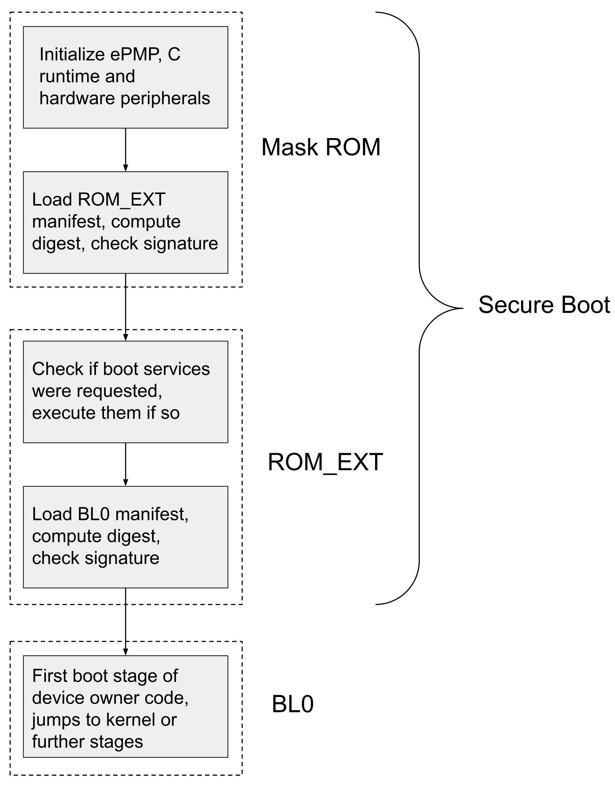
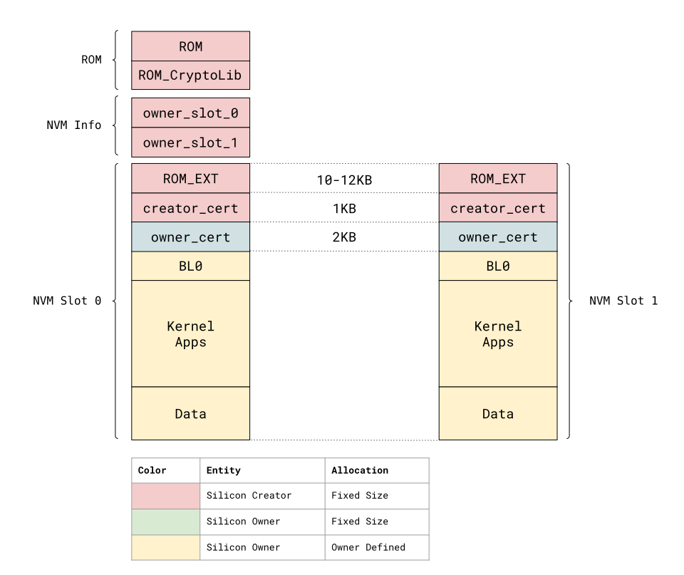

# Secure Boot

  Status: Pre-RFC

The following overview gives a brief, high-level explanation of the OpenTitan Earl Grey secure boot process.
Other OpenTitan tops may implement secure boot differently.
The basic guarantee of secure boot is that *no unauthorized code will be executed before the boot process reaches the device owner's code*.
All executed code must be cryptographically signed by either the owner of the OpenTitan device or the (trusted) entity that originally set up the device at manufacturing time (the "Silicon Creator").

Additionally, the secure boot procedure restricts certain stages to the Silicon Creator, so that even the current device owner can't change them.
Therefore, if the device changes owners, the new owner only has to trust the Silicon Creator, *not* the previous owner(s).

The diagram below summarizes the specific steps involved in the secure boot process:

## ROM

The first stage of secure boot is called "ROM".
ROM is a region of read-only memory that cannot be updated at all after an OpenTitan device is manufactured.
For that reason, the ROM is kept as simple as possible; it does some minimal setup, authenticates the next stage (`ROM_EXT`), and jumps there.

The ROM verifies the signature of `ROM_EXT` before it executes `ROM_EXT`.
OpenTitan supports post-quantum secure boot with ML-DSA-87 signatures, whose verification [OTBN][otbn] accelerates.
The ROM reads the public keys, which it uses to authenticate the `ROM_EXT` signature, from the `ROT_CREATOR_AUTH_CODESIGN` partition of [OTP][otp] (see [Silicon Creator Keys][silicon-creator-keys]).
These public keys correspond to what OpenTitan calls the "Silicon Creator": the entity who was initially involved in the manufacturing of the device.
It's important to distinguish between the unchanging Silicon Creator and the changeable "Silicon Owner", the entity that owns the device at a given time.

On startup, hardware settings use a feature called ["enhanced Physical Memory Protection" (ePMP)][ibex-epmp] to ensure that only the ROM code itself is executable.
For details about how the ROM configures ePMP, see [Memory Protection Module][rom-epmp].
Non-volatile memory (NVM) and MMIO memory regions are unlocked for read/write (for signature verification and configuring peripherals) but are not executable at this stage.

On boot, the ROM code does the following:
1. Initialize any additional ePMP settings beyond what is set by hardware at startup, plus initialize the C runtime and hardware peripherals (e.g. pinmux, UART).
2. Load the "manifest" for `ROM_EXT`, which includes the start and end address of `ROM_EXT` code, cryptographic signatures, public keys, and "selector bits" for hardware information.
    * The manifest's public key fields identify which of the stored [Silicon Creator keys][silicon-creator-keys] should be used for signature verification. If there is no matching stored key, or the matching key is not suitable for the device's lifecycle state, then the boot fails.
    * There are two slots for `ROM_EXT` implementations. ROM will choose a primary boot slot and a secondary one for `ROM_EXT`. If the signature verification for the primary slot fails, then ROM will attempt to boot from the secondary slot.
    * ROM determines the primary boot slot by choosing the `ROM_EXT` implementation with the higher security version. In case the security version is equal for both implementations, ROM will pick the one with the higher major/minor version tuple.
3. Read usage constraints from hardware according to the selector bits from the manifest.
    * The selector bits can choose all or part of the device ID, and/or information about the state of the device. Because the selected constraints are included in the digest, this means the signer of a `ROM_EXT` image can restrict their signature to only certain devices/states.
4. Compute the SHA2-256 digest of the selected usage constraints concatenated with the contents of memory between the `ROM_EXT` start and end address given in the manifest.
5. Check the signatures from the manifest against the digest and the selected Silicon Creator public keys.
    * Every `ROM_EXT` must have a valid ECDSA-P256 signature.
      An ML-DSA-87 signature is required in addition unless ML-DSA-87 verification is disabled in OTP.
      In the `TEST_UNLOCKED*` life cycle states, the ROM does not check ML-DSA-87 signatures.
    * Unlock NVM execution, configure ePMP so that the `ROM_EXT` region is executable, and jump to the start of `ROM_EXT`.

## `ROM_EXT`

The `ROM_EXT` ("ROM extension") stage is another region of read-only memory that is controlled by the Silicon Creator.
However, unlike the ROM, it *can* be updated after the device is manufactured, as long as the new version is signed by the Silicon Creator.

Like the ROM, the `ROM_EXT` must check the signature of the next boot stage (this time against the Silicon Owner's keys, rather than the Silicon Creator’s).
In addition, the `ROM_EXT` initializes Silicon Creator and then Silicon Owner keys using the key manager and performs “boot services”, which are a small set of specific operations that require access to the Silicon Creator's keys (for instance, [transferring the device to a new owner][ownership-transfer]; see [Boot Services](#boot-services)).
These services must happen during boot and not afterwards, because after boot we don't have access to the Silicon Creator keys.

The general procedure for the `ROM_EXT` looks something like this:
1. Load the manifest for BL0 (which has the same format as the `ROM_EXT` manifest described in the ROM procedure).
2. Read usage constraints from hardware according to the selector bits from the manifest.
3. Compute the SHA2-256 digest of the selected usage constraints concatenated with the contents of BL0, as ROM does for `ROM_EXT`.
4. Check the signature(s) from the manifest against the digest and a public code-signing key(s) from the current Silicon Owner (ECDSA-P256 and/or ML-DSA-87).
    * Like the Silicon Creator, the Silicon Owner may have multiple public code-signing keys. How many keys exactly is configurable by the Owner.
    * The number of retries in case verification fails might differ from ROM, and can differ between `ROM_EXT` implementations.
5. Start from the `CreatorRootKey`, which the ROM derived in the [key manager][keymgr_dpe] before it jumped to `ROM_EXT`.
    * The `CreatorRootKey` mixes the device `RootKey`, provisioned by the Silicon Creator at manufacturing time, with information about the specific device, the device health state, the ROM, and a software binding value (the OTP measurement for attestation, or a binding value from the `ROM_EXT` manifest for sealing).
    * The actual values of the `RootKey` and of all keys derived from it are locked inside the key manager and hidden from software. The key manager advances its state to a new value with each additional piece of information.
    * See the [identities and root keys][identities-keys] page for more details about the `CreatorRootKey`, `CreatorIdentity`, `OwnerIntermediateKey`, and the keys derived from them.
6. On every boot, advance the key manager and build the DICE certificate chain used for [attestation][attestation]:
    * The immutable section of the `ROM_EXT` derives the `CreatorIdentity` (the UDS key) from the `CreatorRootKey` and checks it against the UDS certificate endorsed at manufacturing time.
      It then advances the key manager to the `OwnerIntermediateKey` state, mixing in the `ROM_EXT` measurement, and derives the CDI_0 key.
    * The mutable `ROM_EXT` advances the key manager once more, mixing in the BL0 measurement, the owner configuration measurement and the owner's sealing diversifier, and derives the CDI_1 key.
    * The CDI_0 and CDI_1 certificates are compared with the copies cached in NVM; a certificate is regenerated, signed by the previous stage's key and written back only if the measured state has changed.
7. Unlock NVM execution, configure ePMP so that the Silicon Creator controlled regions of memory are not writable and the BL0 region is executable, and then jump to the start of BL0.

Once the code has jumped into the Silicon Owner code at BL0, secure boot in its simplest form is complete.
The Silicon Owner may choose to extend the secure boot process with multiple boot stages of their own; this will differ between device owners, while the stages described here are guaranteed by the Silicon Creator and will be shared by OpenTitan implementations.
If any signature verification in the above process fails, or there is any kind of unexpected error, the device will fail to boot.

# Silicon Creator Keys

The ROM reads the Silicon Creator public keys from the `ROT_CREATOR_AUTH_CODESIGN` partition of [OTP][otp], which has the following key slots:
- 4 ECDSA-P256 key slots, and
- 4 ML-DSA-87 key slots.

This redundancy partially protects against the scenario in which one of the keys is compromised; any OpenTitan devices produced after the key is known to be compromised can mark the compromised key invalid, without requiring a full new ROM implementation.
Devices produced before the key is known to be compromised are not protected by this strategy.

The `ROT_CREATOR_AUTH_STATE` partition of OTP holds the state of each key slot: blank, provisioned or revoked.
The ROM accepts only provisioned keys.

Each key slot has a key type, which determines the life cycle states in which the ROM accepts the key:

| Key type | `TEST_UNLOCKED*` | `DEV` | `PROD`, `PROD_END` | `RMA` |
|----------|------------------|-------|--------------------|-------|
| test     | yes              | no    | no                 | yes   |
| dev      | yes              | yes   | no                 | yes   |
| prod     | yes              | yes   | yes                | yes   |

If the key indicated in the manifest has a key type that doesn't match the life cycle state of the device, the boot fails.

# Terminology Quick Reference

## OpenTitan Logical Entities

*   **Silicon Creator:** The owner of the public keys injected into the OpenTitan device at manufacturing time.
    Signs the `ROM_EXT` boot stage (and certain provisioning binaries).
*   **Silicon Owner:** The individual or group who has taken ownership of the OpenTitan device by adding their public keys during an ownership transfer.
    Signs all boot stages after `ROM_EXT`.

The Silicon Creator and the Silicon Owner may be the same individual or group, but are not necessarily so.
The Silicon Owner can change during the lifetime of the device, but the Silicon Creator cannot.

## RISC-V Concepts:

*   **ePMP:** Enhanced Physical Memory Protection unit:
    [Ibex Physical Memory Protection][ibex-epmp].
    Can be configured to allow or prevent read (R), write (W) and/or execute (X)
    access to regions of memory.

## Boot stages:

*   `ROM`: [Mask ROM][glossary-mask-rom], sometimes known as Boot ROM.
*   `ROM_EXT`: ROM Extension. Stored in NVM and signed by the Silicon Creator.
*   `BL0`: Bootloader. Signed by the Silicon Owner.
*   `Kernel`: Post-bootloader code. Signed by the Silicon Owner.

# Boot Policy

In order to provide a flexible boot mechanism the Boot Info page will store a
structure called the Boot Policy. The boot policy dictates the boot flow,
including storing boot attempts and successes for a given `ROM_EXT`, allowing
the ROM code to decide when to mark a `ROM_EXT` good or bad. The boot policy
also contains directions to `ROM_EXT` about which slot it loads silicon owner
code from. TODO(gdk): Expand on policy.

# Memory Layout

Memory on OpenTitan can be considered as split into three separate regions: ROM,
NVM Info, and addressable NVM "data". The addressable NVM is further divided
into two equally-sized regions called NVM Slot 0 and NVM Slot 1. The beginning
addresses for NVM Slot 0 and NVM Slot 1 are the only fixed points of
reference that the system is opinionated about. It is expected that a Silicon
Owner might arbitrarily reserve space at the end of each slot to use as
additional storage.

# Boot Services

Boot Services refers to the functionality stored inside of `ROM_EXT` that
can be controlled via specific messages passed from Silicon Owner code
in retention SRAM. Since `ROM_EXT` is responsible for the boot process and
is the only software on the device which can manipulate identities belonging to
the Silicon Owner, these services are required to perform actions such as
ownership transfer and firmware update.

## Entering Boot Services

Boot services are invoked by placing a request message in the creator area of
retention SRAM and resetting the system.
On the next boot, `ROM_EXT` handles the request if:

*   the reset was not caused by a low power exit, or the current owner
    configuration enables boot services after a low power wakeup, and
*   the message in retention SRAM has a valid boot services header.

`ROM_EXT` writes its response to the same location in retention SRAM.
Requests can also be sent to `ROM_EXT` through the [rescue protocol][rescue].

## Commands

*   `EMPTY`: Does nothing.
*   `ENTER_RESCUE`: Enters [rescue mode][rescue].
*   `NEXT_BL0_SLOT`: Requests that `ROM_EXT` boots the given BL0 slot on the
    next boot, and optionally sets the primary BL0 slot.
    A Silicon Owner uses this to boot newly written firmware in the other slot
    as part of a firmware update.
*   `MIN_BL0_SEC_VER`: Sets the minimum security version of BL0 that `ROM_EXT`
    accepts.
*   `OWNERSHIP_UNLOCK`: As per [Ownership Transfer][ownership-transfer]'s
    [Unlock Flow][ot-unlock-flow], relinquish ownership of the device.
*   `OWNERSHIP_ACTIVATE`: Activates the ownership configuration of the next
    owner and completes an [ownership transfer][rom-ext-ownership].

# Manifest Requirements

This document does not prescribe an exact data structure for the `ROM_EXT` manifest as seen by the ROM.
For that information, see the [manifest format page][manifest-format].
However, these are the requirements that the manifest format is required to support:

*   **Hash scheme selection.** The manifest must specify the hashing scheme that
    covers the `ROM_EXT` slot.
*   **Signature scheme selection**. The manifest must specify the signature
    scheme that covers the `ROM_EXT` slot.
*   **Key derivation constants**. As specified in the
    [Identities and Root Keys][identities-keys] document, the manifest header
    must include constants used to derive the next key generation.
*   **Header version.** The version of the `ROM_EXT`. This version field is used
    as part of the measurements for key derivations, and can be used as a
    constraint for the boot policy.
*   **Rollback protection.** A generation marker that is used by `ROM_EXT` to
    determine if this version is bootable or is considered a rollback.
*   **Entrypoint.** The executable entrypoint for this `ROM_EXT` slot.

<!-- TODO: Update with published documents when available. -->
[attestation]: ../attestation/README.md
[glossary-mask-rom]: ../../../glossary.md#mask-rom
[ibex-epmp]: https://ibex-core.readthedocs.io/en/latest/03_reference/pmp.html
[identities-keys]: ../identities_and_root_keys/README.md
[keymgr_dpe]:  ../../../../hw/ip/keymgr_dpe/README.md
[manifest-format]: ../../../../sw/device/silicon_creator/rom_ext/doc/manifest.md
[rescue]: ../../../../sw/device/silicon_creator/rom_ext/doc/rescue.md
[rom-epmp]: ../../../../sw/device/silicon_creator/rom/doc/memory_protection.md
[rom-ext-ownership]: ../../../../sw/device/silicon_creator/rom_ext/doc/ownership.md
[otbn]: ../../../../hw/ip/otbn/README.md
[otp]: ../../../../hw/top_earlgrey/doc/design/README.md#otp
[ot-unlock-flow]: ../ownership_transfer/README.md#unlock-ownership
[ownership-transfer]: ../ownership_transfer/README.md
[silicon-creator-keys]: #silicon-creator-keys
