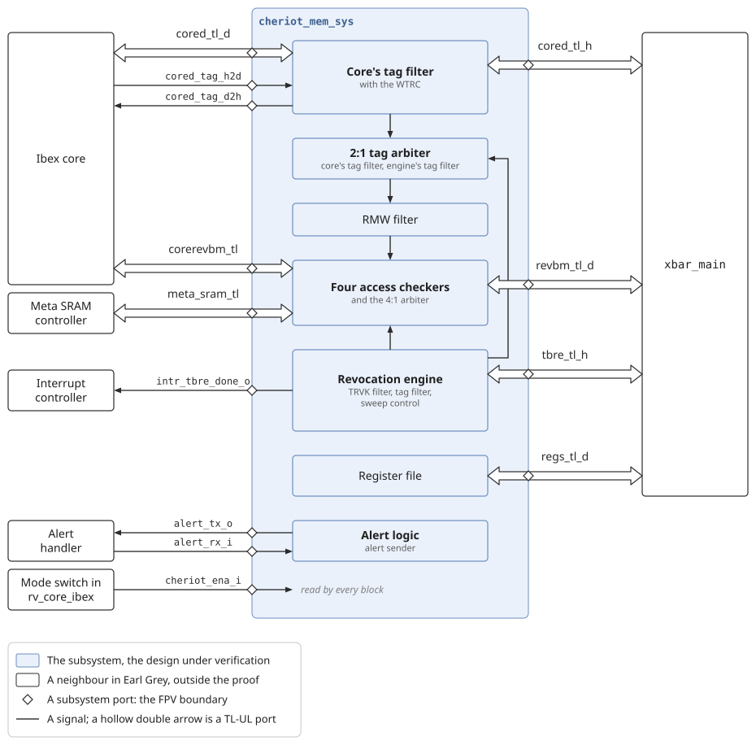
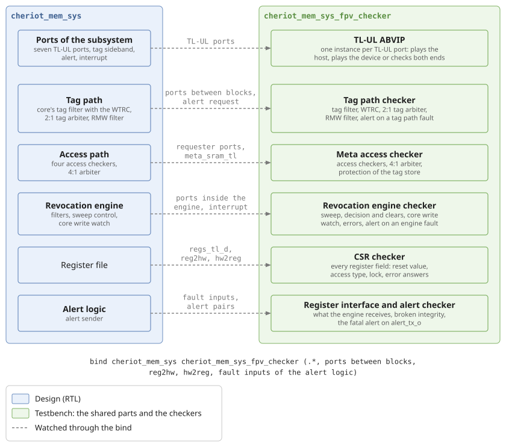
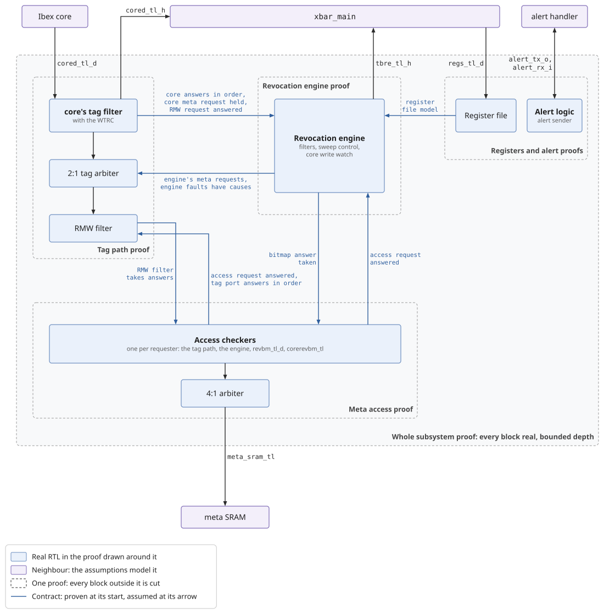

# CHERIoT memory subsystem FPV testplan

This page is the plan of a new FPV environment for the CHERIoT memory subsystem in Earl Grey.
The environment proves the requirements of the tag path, the access rules of the meta SRAM, the revocation engine and the registers.
[Scope](#scope) lists what it checks and what it leaves out.

## The CHERIoT memory subsystem in Earl Grey
The subsystem sits between the CHERIoT-capable Ibex core and the main crossbar `xbar_main`.
It stores one validity tag for each capability, and the revocation bitmap of the heap, in a meta SRAM.
The [theory of operation](../theory_of_operation.md) describes how it works.
The subsystem does four jobs:

* It splits each data access of the core into a data access towards the crossbar and a tag access towards the meta SRAM, and it joins the two answers.
* It merges four requesters onto the port `meta_sram_tl`, and an access checker lets each requester reach only the region that it owns.
* Its revocation engine sweeps a range of capabilities and clears the tag of each revoked capability.
  The registers, the ports and the testpoints of the engine carry the prefix `tbre`.
* It reports the fatal alert `fatal_fault` to the alert handler.

The input `cheriot_ena_i` selects CHERIoT mode, or ePMP mode, in which the core uses no capabilities.

The environment sits at the subsystem's own ports.
The table says what it does with the ports of each neighbour.
An input marked free can take any value in any cycle.

| Neighbour | Ports | In the environment |
|---|---|---|
| Ibex core | `cored_tl_d`, `cored_tag_h2d`, `cored_tag_d2h`, `corerevbm_tl` | The requests follow the core rules ([Assumptions](#assumptions)). The answers and `cored_tag_d2h` are checked. |
| Mode switch in `rv_core_ibex` | `cheriot_ena_i` | Free at reset, then constant ([Constraints](#constraints)). |
| Main crossbar `xbar_main` | `regs_tl_d`, `revbm_tl_d`, `cored_tl_h`, `tbre_tl_h` | The crossbar follows the TL-UL rules ([Assumptions](#assumptions)). The answers on `regs_tl_d` and `revbm_tl_d` and the requests on `cored_tl_h` and `tbre_tl_h` are checked. |
| Meta SRAM controller | `meta_sram_tl` | The answers follow the TL-UL rules ([Assumptions](#assumptions)). The requests are checked. |
| Alert handler | `alert_rx_i`, `alert_tx_o` | `alert_rx_i` follows the alert protocol ([Assumptions](#assumptions)). The alert on `alert_tx_o` is checked. |
| Interrupt controller | `intr_tbre_done_o` | The interrupt is checked. |
| Clock and reset managers | `clk_i`, `rst_ni` | One clock. Every proof starts with the reset applied. |

## How the plan fits together
The plan is a chain of four parts, and each part points to the next.

1. **Specification.**
   The documents that say what the subsystem must do: [Sources](#sources) lists them.
2. **Requirements** ([requirements.md](requirements.md)).
   270 statements of what the subsystem must do, in 15 groups, one group per feature.
3. **Testpoints** ([testplan](../../data/cheriot_mem_sys_fpv_testplan.hjson)).
   42 entries of the testplan.
   A testpoint is one behaviour of a feature that must be shown to hold, written as a few sentences, with the requirements it covers.
   The module that proves it is a checker, and one checker proves one or more testpoints ([Feature checkers](#feature-checkers)).
4. **Checks.**
   174 checks, the rows of the testpoints' check tables.
   A check is a sentence that says what must hold.
   Each has a planned assertion, named `assert_<Testpoint>_<Check>`.
   A requirement names the checks that decide it, and why.

The design also has access checkers, which are blocks of the subsystem and not part of the testbench.

### One example through the chain
The example uses terms that the requirements page defines ([Terms](requirements.md#terms)).

| Step | Example |
|---|---|
| Specification | [Tag Filter](../theory_of_operation.md#tag-filter); [cheriot.rst, Data Memory Tag Interface](../../../../vendor/lowrisc_ibex/doc/03_reference/cheriot.rst) |
| Requirement | [REQ_TF_02a](requirements.md#req_tf_02a): In CHERIoT mode, a 64-bit-aligned read to a tagged region that the core hints as a capability load shall issue a meta request. |
| Testpoint | [`tf_lookup`](../../data/cheriot_mem_sys_fpv_testplan.hjson#tf_lookup): A request that needs a lookup issues exactly one meta request, in the same cycle. Every other request issues none. |
| Checker | The tag path checker, the module that holds the assertions of `tf_lookup` |
| Check | *lookup in same cycle*, one of the 3 checks of `tf_lookup` (*lookup in same cycle*, *no unneeded lookup*, *lookup carries valid integrity*) |
| Planned assertion | `assert_TfLookup_LookupInSameCycle` |
| Why the check proves the requirement | The check requires a meta request for every request that needs a lookup. A hinted aligned read to a tagged region in CHERIoT mode needs one, so a missing lookup fails the check. |

### Sources
Each requirement names its source: a section, a register or a configuration key of the documents below.
Where none of these documents states the rule, the requirement says so.

| Source | Documents | What the plan takes from them |
|---|---|---|
| The block specification | [theory of operation](../theory_of_operation.md), [interfaces](../interfaces.md), [programmer's guide](../programmers_guide.md), [registers](../registers.md), [overview](../../README.md), [block description](../../data/cheriot_mem_sys.hjson) | The rules of every datapath block, register, alert and countermeasure |
| The core | [Ibex CHERIoT extension](../../../../vendor/lowrisc_ibex/doc/03_reference/cheriot.rst), [Ibex load-store unit](../../../../vendor/lowrisc_ibex/doc/03_reference/load_store_unit.rst), [`rv_core_ibex` theory of operation](../../../../top_earlgrey/ip_autogen/rv_core_ibex/doc/theory_of_operation.md), CHERIoT architecture specification v1.0 | What the core sends and expects: the tag signals, the order of its accesses, the capability rules |
| Common rules | [TL-UL](../../../tlul/README.md), [TL-UL protocol checker](../../../tlul/doc/TlulProtocolChecker.md), [comportability](../../../../../doc/contributing/hw/comportability/README.md), [register tool](../../../../../util/reggen/README.md), [alert handler theory of operation](../../../../top_earlgrey/ip_autogen/alert_handler/doc/theory_of_operation.md), [common test library](../../../../dv/sv/cip_lib/README.md), TileLink specification 1.9.3 | Bus handshakes and answers, interrupts, alerts and register behaviour |

### Check kinds
The testplan gives each check a kind:

| Kind | What it says |
|---|---|
| `forward` | When the cause happens, the design responds, and in time. |
| `backward` | The design responds only when the cause happened. |
| `both` | The check holds in both directions: the design responds when the cause happens, and only then. |
| `safety` | The condition holds in every cycle, whatever came before. |
| `liveness` | Something must happen at some point, for example that every request is accepted and answered. Where the answer depends on a neighbour, the check needs the neighbour to accept and answer too ([Assumptions](#assumptions)). |
| `stable` | A value does not change without its cause. |

## Scope
### Features
| Feature | Checked by |
|---|---|
| The core's tag filter, with the write-to-read-and-compare filter (WTRC) for a capability store to the NVM | Tag path checker |
| The 2:1 tag arbiter and the read-modify-write (RMW) filter | Tag path checker |
| The access checkers, the 4:1 arbiter and the protection of the tag store | Meta access checker |
| The revocation engine: start, status, interrupt, sweep, tag clears and errors | Revocation engine checker |
| The registers: reset value, access type and lock of every field, and every cause of a bus error | CSR checker |
| The register interface: a broken integrity code, the integrity codes of the answers, the request rate | Register interface and alert checker |
| The fatal alert on `alert_tx_o`: each cause, the alert test, the repeat until reset, the answer to a ping | Register interface and alert checker |
| The TL-UL protocol on every port | TL-UL ABVIP, a set of protocol assertions |
| A tag read after a write, no deadlock, a revoked capability's tag after a sweep | The checks of the checkers above, combined |

### Security countermeasures
The table shows each countermeasure of the block description and the testpoints of this plan that check the behaviour behind it.
OpenTitan's testplan for the countermeasures is [`cheriot_mem_sys_sec_cm_testplan.hjson`](../../data/cheriot_mem_sys_sec_cm_testplan.hjson).

| Countermeasure | What it is | Testpoints |
|---|---|---|
| `BUS.INTEGRITY` | Bus integrity. Every request that the subsystem generates carries a valid command integrity code. | `tf_lookup`, `wtrc_store`, `rmw_read`, `rmw_write_back`, `tbre_sweep`, `tbre_decision` |
| `MEM.SW_NOACCESS` | The capability tag store is not memory mapped. No request outside its requester's region reaches the meta SRAM. | `meta_refuse`, `tag_isolation` |
| `INTERSIG.MUBI` | The mode enable is a multi-bit signal. Any value other than `MuBi4True` is ePMP mode, in which no request reaches the meta SRAM. | `tf_lookup`, `meta_refuse`, `tag_isolation` |
| `CORED_TAG.INTERSIG.MUBI` | The tag sideband of the core's data port is a multi-bit signal. Only `MuBi4True` reads as a set tag, and a request with an invalid encoding raises the fatal alert. | `tf_meta_request`, `tf_sticky_tag`, `tag_alerts` |

### Out of scope
The plan leaves out the cases below.
Each point gives the reason.

* **The TL-UL integrity functions.**
  The environment computes the integrity codes it expects with the same functions that the design uses.
  It therefore checks that the subsystem encodes the right fields and that it rejects a wrong code.
  It does not check that the functions compute the right code.
* **The lockstep countermeasure.**
  The block description marks `LOGIC.SHADOW`, the lockstep operation of the subsystem, as not implemented.
  No document states what the lockstep requires of the subsystem, so the plan has no requirement for it.

## Testbench architecture
This is the planned architecture.
The formal top is the whole `cheriot_mem_sys`, with Earl Grey's parameters.
One environment module, `cheriot_mem_sys_fpv_env`, holds the design and leaves its inputs to the formal tool.
One checker module, `cheriot_mem_sys_fpv_checker`, is bound into the design.
It holds the two shared parts and the feature checkers of this section.
The checker module reads every port of the subsystem and these internal signals:

* the ports between the blocks of the tag path and of the revocation engine, such as the input and the output of the 2:1 tag arbiter;
* the register file's outputs to the hardware and the hardware's writes into the registers;
* the fault inputs of the alert logic and the request that reaches the alert sender.

Each rule that the environment makes about a neighbour is written once.
The formal tool assumes it, and a simulation of the same bind asserts it.

The shared parts are the TL-UL ABVIP and the CSR checker.

### TL-UL ABVIP
`tlul_abvip` is a set of TL-UL protocol assertions for formal (ABVIP stands for assertion-based verification IP).
An instance sits on each TL-UL port and plays one of three roles:

| Role | Where | What the instance does |
|---|---|---|
| Plays the host | A port where a neighbour sends requests | It assumes the host rules and asserts the device rules. |
| Plays the device | A port where a neighbour answers | It assumes the device rules and asserts the host rules. |
| Checks both ends | A link between two blocks of the subsystem | It asserts every rule. In a proof that cuts one end of the link, it plays that end. |

A rule that is specific to this design, such as the order of a capability's two words, is an assumption on top of the instance ([Assumptions](#assumptions)).
The testpoint `tlul_protocol` holds the check that the TL-UL rules hold on every port.

### CSR checker
The CSR checker proves the register file.
For every register it checks the access type, the reset value and the lock.
It also checks the answer to every cause of a bus error.

The checker keeps a mirror, which is its own copy of every register field.
It updates the mirror on each write that software makes over the bus and on each write that hardware makes.
The checker's assertions compare the register file with the mirror.

The checker covers every register, including `INTR_STATE`, `TBRE_REGWEN`, `TBRE_START`, `TBRE_STATUS` and `TBRE_EPOCH`, which hardware writes.

### Feature checkers
| Checker | Testpoints it proves |
|---|---|
| Tag path checker | `tf_*`, `wtrc_*`, `arb_*`, `rmw_*`, `tag_alerts` |
| Meta access checker, once for each of the four requester ports | `meta_*`, `tag_isolation` |
| Revocation engine checker | `tbre_*`, `alert_causes` |
| Register interface and alert checker | `csr`, `bus`, `alert` |

* [Features](#features) says what each checker checks.
* The [CSR checker](#csr-checker) has no testpoint of its own.
  A requirement that the CSR checker decides names the CSR checker in its "Checked by" column on the [requirements page](requirements.md).
  The testpoint `csr` holds the checks of the register file's outputs to the revocation engine and of the request rate of the register interface.
* The testpoints `contracts` and `tlul_protocol` hold checks on the blocks of several checkers.
  Each of their checks is proven in the proof of the checker that holds its block.
* The testpoints `tag_read_after_write`, `tag_no_deadlock` and `rev_end_to_end` have no assertions of their own.
  Each follows from the checks of the checkers on its path, and the testplan names those checks.
* Each assertion has the name that its check plans, such as `assert_TfMetaRequest_TagWordAndBit`.

### Reference value sources
Each assertion compares the design with a reference value, for example the tag word that an address maps to.
If a checker took such a value from the RTL, a wrong value in the RTL would be wrong on both sides, and the assertion would still pass.
The environment therefore takes its reference values from the documents.

| Reference value | Where the environment takes it from |
|---|---|
| The address ranges of the regions | The parameters of `interfaces.md` |
| The tag word of an address, and the revocation word and bit of a heap address | The meta SRAM address map of the theory of operation |
| The tag bit of an address within its word | No document states the bit order of the tags. The environment takes the order that the theory of operation states for the revocation bitmap. |
| The swept capabilities of a sweep and the starts that are taken | The revocation engine section of the theory of operation |
| A capability's base and whether it is a sealing capability | The CHERIoT architecture specification. The environment decodes the capability itself. |
| Which accesses an access checker lets through | The access checkers section of the theory of operation |
| Register offsets, field positions, access types and reset values | The register description, `cheriot_mem_sys.hjson` |
| TL-UL integrity codes | The integrity functions of `tlul_pkg`, in the RTL |

The integrity codes are the one reference value that a checker computes with the RTL's own functions, which is why the integrity functions are [out of scope](#out-of-scope).
The environment also uses the RTL's type definitions of the ports and the register structs, to connect to the design.

## Verification strategy
Three words describe how the proofs are set up:

* An **abstraction** lets a part of the design, or its start state, take more values than it really can, or leaves a part out, so that one proof covers more cases.
  It removes no real behaviour.
* A **constraint** narrows what the proofs explore.
  Each constraint says what it leaves unchecked.
* An **assumption** is a rule that the environment makes the neighbours of the subsystem follow.
  Each assumption names the document that gives the rule, or says that no specification gives it.

### Proofs
The plan splits the subsystem by feature and composes the proofs by assume-guarantee reasoning.
Each feature proof holds the real blocks of one checker and cuts every other block ([Abstractions](#abstractions)).
Where a check depends on a cut block, the proof assumes a contract about that block, and the proof that holds the block proves the contract.

* Each arrow is a contract. The proof at its start proves it, and the proof that it points to assumes it.
* A few blocks are real in more than one proof, such as the alert logic. The table lists the real blocks of every proof.

| Proof | Checker | Testpoints | Real blocks, and setup |
|---|---|---|---|
| Tag path | Tag path checker | `tf_*`, `wtrc_*`, `arb_*`, `rmw_*`, `tag_alerts` | The core's tag filter with the WTRC, the 2:1 tag arbiter, the RMW filter, the core write watch, the alert logic |
| Faults of a capability store | Tag path checker | The checks of `wtrc_faults` on a word that is out of sequence or partial | As the tag path proof. The core is free to send the words of a capability store out of sequence ([Assumptions](#assumptions)). |
| Meta access | Meta access checker | `meta_*`, `tag_isolation` | The four access checkers, the 4:1 arbiter |
| Revocation engine | Revocation engine checker | `tbre_*`, `alert_causes` | The engine with its filters, the sweep control, the core write watch, the 2:1 tag arbiter, the alert logic. The register file follows a model, and the epoch count starts at any value. |
| Registers | CSR checker | The registers ([CSR checker](#csr-checker)) | The register file, the alert logic, the alert sender. What hardware writes into the registers is free. |
| Register interface and alert | Register interface and alert checker | `csr`, `bus`, `alert` | As the registers proof. Every fault input of the alert logic is free. |
| Whole subsystem | All checkers | Every assertion of the checkers, `contracts` included | Every block. The proof runs to a bounded depth, and its result names the depth. |
| The design's own assertions | None: the assertions are written in the RTL | - | Each assertion is proven in the feature proof whose real blocks hold it. |

* A **contract** is a property that one checker assumes about a block that its proof cuts, and that another checker proves on the real block.
  The testpoint `contracts` holds the checks that prove the contracts. The figure names them in short.
* No proof assumes a contract that was proven with its own help, so the proofs run in an order.
* A check of kind `liveness` that needs an assumption about a neighbour runs in a proof of its own, because that assumption would narrow the other checks of its checker.

### Abstractions
No abstraction edits the RTL. The Proofs table names the proofs that use each one.

| Abstraction | Why the result holds for the design | What another check covers |
|---|---|---|
| A block outside the checker is cut: its outputs are free, and contracts limit them where a check needs it. | The free outputs include every value that the real block produces. | The checker that holds the block proves its outputs. |
| In the revocation engine proof, the register file follows a model: the sweep range locked while `TBRE_REGWEN` is 0, the start strobe only while it is 1, the interrupt state rising only on a set request, `TBRE_STATUS.busy` as the engine wrote it. | The checks of `csr` prove that the real register file follows the model. | The CSR checker checks what software reads through `regs_tl_d`. |
| In the revocation engine proof, `TBRE_EPOCH.count` starts at any value, so the proof reaches the wrap of the count. | Every start value is one that the count reaches after enough sweeps. | The CSR checker checks the reset value of the count. |

### Constraints
The last sentence of each constraint says what it leaves unchecked.

* **The mode enable keeps its value from reset** (`cheriot_ena_i`).
  The mode enable is driven by a write-once switch in `rv_core_ibex` ([Block Diagram](../theory_of_operation.md#block-diagram)), and a proof takes each of its 16 values.
  The Ibex documentation requires software to run no load and no store while the mode changes ([cheriot.rst, Switching to CHERIoT Mode at Runtime](../../../../vendor/lowrisc_ibex/doc/03_reference/cheriot.rst)).
  No document says what the subsystem does with an access that is in flight when the mode enable changes.
  The proofs therefore do not check the change from one value to another.
* **The proofs use one parameter set.**
  The proofs run with the parameter set of Earl Grey, which is the only set that the block's documents support ([Supported Parameter Sets](../interfaces.md#supported-parameter-sets)).
  The plan does not show that the requirements hold for another parameter set.

* **No signal integrity error on the alert lines.**
  The environment keeps each signal pair of the alert handler valid ([Assumptions](#assumptions)).
  The plan does not check how the alert sender answers a pair that stays not complementary.
* **No in-band reset of the alert handler.**
  The in-band reset is the alert handler's re-initialization.
  During it, the alert handler puts a signal integrity error on its signal pairs on purpose ([Employed Solution](../../../../top_earlgrey/ip_autogen/alert_handler/doc/theory_of_operation.md#employed-solution)).
  The proofs do not show the subsystem during an in-band reset.

### Assumptions
Each assumption models a neighbour of the subsystem.
**Models** names the neighbour and the source of the rule, and **Why** says what the proofs need it for.
Every other input is free, broken integrity codes and every value of the tag sideband included.

* **The core holds a request unchanged until the subsystem accepts it** (`cored_tl_d`, `cored_tag_h2d`).
  * **Models:** the core, `rv_core_ibex` ([Block Diagram](../theory_of_operation.md#block-diagram)).
  * **Why:** the tag filter sends each request to the host port and to the meta port.
    A request that changed in between would reach the two ports as two different requests.
* **The core has at most two requests outstanding** (`cored_tl_d`).
  * **Models:** Ibex's load-store unit ([Tag Filter](../theory_of_operation.md#tag-filter)).
  * **Why:** the tag filter keeps the tag information of two outstanding requests, which matches the load-store unit.
    A third outstanding request is a case the core never creates.
* **The core loads and stores a capability as two consecutive words**, the upper word with the lower word's tag or an invalid one (`cored_tl_d`).
  * **Models:** Ibex's load-store unit ([cheriot.rst, Data Memory Tag Interface](../../../../vendor/lowrisc_ibex/doc/03_reference/cheriot.rst), [load_store_unit.rst, Data-Side Memory Interface](../../../../vendor/lowrisc_ibex/doc/03_reference/load_store_unit.rst), [Write-to-Read-and-Compare Filter (WTRC)](../theory_of_operation.md#write-to-read-and-compare-filter-wtrc)).
  * **Why:** the tag filter carries the lower word's tag to the upper word, and the WTRC compares the two words of a store as one pair.
    The proof of the faults of a capability store drops this assumption and the next one, so that it reaches words out of sequence.
* **A write narrower than a whole word carries no tag** (`cored_tag_h2d`).
  * **Models:** the core under the CHERIoT ISA.
    Only a store of a tagged capability with the instruction `CSC` sets a tag (CHERIoT architecture specification v1.0, section 7.7).
    The core writes a capability as two whole words ([cheriot.rst, Data Memory Tag Interface](../../../../vendor/lowrisc_ibex/doc/03_reference/cheriot.rst)).
    No document states the rule for the data port itself.
  * **Why:** without it, the proofs would see tags set by stores that the core cannot make.
* **`xbar_main` answers in request order** (`cored_tl_h`, `tbre_tl_h`).
  * **Models:** the crossbar. The load-store unit assumes it on `cored_tl_h` ([load_store_unit.rst, Protocol](../../../../vendor/lowrisc_ibex/doc/03_reference/load_store_unit.rst)); no specification states it for `tbre_tl_h`.
  * **Why:** each tag filter pairs an answer with its request by their order, so an answer out of order would receive the tag of another request.
* **`xbar_main` answers in a later cycle, and holds an answer until the subsystem takes it** (`cored_tl_h`).
  * **Models:** the Earl Grey crossbar. No specification states these rules.
  * **Why:** an answer in the cycle of its request would reach the WTRC before the WTRC records the request.
    An answer that changed while it waits would withdraw the tag write of a capability store.
* **The meta SRAM answers in a later cycle, in order, and holds an answer until it is taken** (`meta_sram_tl`).
  * **Models:** the Earl Grey meta SRAM controller. No specification states these rules.
  * **Why:** the path from the RMW filter to the meta SRAM has no register ([Timing](../theory_of_operation.md#timing)), so the RMW filter pairs each answer with its operation by the meta SRAM's own timing.
    Only the proof that the tag port answers in order uses this assumption.
* **The meta SRAM returns the word last written to an address** (`meta_sram_tl`).
  * **Models:** the meta SRAM as a memory.
  * **Why:** the testbench does not model the memory, and the end-to-end tag requirements follow from the checks of the tag path only if the memory keeps what it is given.
    No proof uses it.
* **The alert handler follows the alert protocol** (`alert_rx_i`): the four-phase handshake, signal pairs that differ for at most one cycle when they change, and at least 4 cycles between pings.
  * **Models:** the alert handler ([Differential Alert Signaling](../../../../top_earlgrey/ip_autogen/alert_handler/doc/theory_of_operation.md#differential-alert-signaling), [Skew on Asynchronous Differential Pairs](../../../../top_earlgrey/ip_autogen/alert_handler/doc/theory_of_operation.md#skew-on-asynchronous-differential-pairs), [LFSR Timer](../../../../top_earlgrey/ip_autogen/alert_handler/doc/theory_of_operation.md#lfsr-timer)).
    No specification bounds its time to answer, so the proofs use a fixed bound.
  * **Why:** a handler that broke the protocol would make a correct alert sender fail its checks.
* **The neighbours follow the TL-UL rules**: a device returns the request's source ID, and a host leaves the top bits of the source ID free.
  * **Models:** every TL-UL neighbour, played by the TL-UL ABVIP ([Source ID requirements for device elements](../../../tlul/README.md#source-id-requirements-for-device-elements), [Source ID requirements for host elements](../../../tlul/README.md#source-id-requirements-for-host-elements), [Source ID growth](../../../tlul/README.md#source-id-growth)).
  * **Why:** without these rules the checks would see answers that no real block makes.
    The arbiters add their bits at the top of the source ID, so a host that used those bits would receive answers meant for another request.
* **The neighbours eventually accept and answer every request, and a host eventually takes an answer** (`cored_tl_h`, `tbre_tl_h`, `meta_sram_tl`, `revbm_tl_d`, `corerevbm_tl`, `regs_tl_d`).
  * **Models:** TileLink's rule against deadlock (TileLink specification 1.9.3, section 5, page 29).
  * **Why:** a neighbour that never answers would fail the checks that every request is answered, for a reason outside the subsystem.
    Only the checks of kind `liveness` need it.

The plan never uses the design's own assertions as assumptions.

### Vacuity and covers
An assertion is vacuous when its trigger never happens: it then passes without checking anything.
Covers guard against this, and every proof runs its covers before its assertions.
Every proof has at least these covers:

* **Precondition covers**, one per assertion, show that the assertion's trigger can happen.
* **Witness covers**, one per assumption, constraint and assumed contract, show that the environment still allows the legal case it is about, so the environment is not over-constrained.

A requirement does not close while one of its covers is unreached ([Sign-off criteria per stage](#sign-off-criteria-per-stage)).

### Sign-off criteria per stage
The stages are OpenTitan's [verification stages for FPV](../../../../../doc/project_governance/development_stages.md), which give the full criteria.
A requirement closes when its checks are proven, their covers are reached, and every contract that they rely on is proven.

| Stage | OpenTitan's main criteria | In this plan |
|---|---|---|
| V1 | Testplan reviewed, assertions bound, the main functional path proven. | The main tag path, without its error cases and the capability store to the NVM: `tf_forward`, `tf_lookup`, `tf_meta_request`, `tf_sticky_tag`, `arb_forward`, `arb_return`, `rmw_read`, `rmw_write_skip`, `rmw_write_back`, `meta_forward` and `meta_return`, with the TL-UL ABVIP bound. |
| V2 | Every assertion written, assumptions reviewed, 90 % proven, 90 % code and 75 % cone-of-influence coverage. | Every other functional testpoint, `contracts`, `tlul_protocol` and the CSR checker. |
| V2S | The checks of the security countermeasures pass. | `tf_errors`, `wtrc_faults`, `rmw_errors`, `tag_alerts`, `meta_refuse`, `tag_isolation`, `tbre_errors`, `alert_causes` and `alert`. |
| V3 | Every assertion proven, 100 % code and cone-of-influence coverage. | Every testpoint. |

## Building and running tests
The environment's [dvsim](https://github.com/lowRISC/dvsim) entry is `cheriot_mem_sys_fpv`, in the formal configuration of Earl Grey.

## Requirements
[requirements.md](requirements.md) holds the 270 requirements, for reading.
[`cheriot_mem_sys_fpv_requirements.hjson`](../../data/cheriot_mem_sys_fpv_requirements.hjson) holds the same rows as data.
263 of them state a rule the specification gives (kind `spec`).
7 state a rule that no specification gives (kind `RTL`).
The `RTL` rows follow the design's present behaviour.
10 of the `spec` rows mark one part of their rule that no specification gives, and each says what its check follows for that part.

## Testplan
[Testplan](../../data/cheriot_mem_sys_fpv_testplan.hjson)
