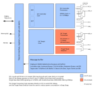
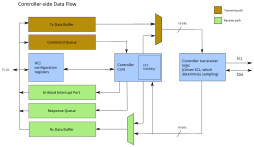
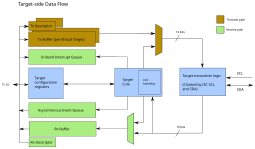
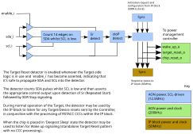

# Theory Of Operation

This IP block implements both Controller and Target functionality for the Improved Inter-Integrated Circuit (I3C) bus.
The I3C bus, specified by the MIPI Alliance, is a successor to the popular I2C bus, offering higher data rates whilst also addressing a number of the well-known deficiencies of the I2C.

It has been designed and built for compliance with the following specifications:

 - [MIPI Alliance Specification for I3C Basic, Version 1.2 Public Release Edition.](https://www.mipi.org/mipi-i3c-basic-download)
 - [MIPI Alliance Specification for I3C TCRI, Version 1.0 (Public Release Edition).](https://www.mipi.org/mipi-i3c-tcri-download)
 - [MIPI Alliance Specification for I3C HCI, Version 1.2 (Public Release Edition).](https://www.mipi.org/mipi-i3c-hci-download)

## Overview

The following diagram presents an overview of the OpenTitan I3C IP block:

In I3C terminology, the Controller is responsible for initiating and managing most of the transfers occurring on the bus, and Targets are typically mostly-passive devices that respond to requests.

Both the Controller and the Target functionality within this IP block support the following bus modes:

 - Single Data Rate (SDR).
   This is broadly similar to the signaling of the I2C bus, including the same start (S), repeated start (Sr) and stop (P) signaling.
   SDR transfers 8 data bits and a T-bit in 9 SCL cycles, so a 12.5 MHz SCL carries at most 11.1 Mbps of data.
 - Double Data Rate (HDR-DDR).
   This mode is new to I3C and employs an entirely different logical protocol whilst also transferring data on both edges of the SCL clock signal.
   HDR-DDR mode also includes error detection using parity and checksums.
   It transfers 16 data bits, a 2-bit preamble and 2 parity bits in 10 SCL cycles, so a 12.5 MHz SCL carries at most 20 Mbps of data.

The Controller and Target sides of the IP block operate independently on the same bus, but they share the TL-UL register interface and in particular the message buffer.

Also shared between the Controller and Target sides of the IP block is a single clock signal, upon which most of the design operates.
The IP block is, however, designed to accommodate a number of different clock frequencies.

In order to achieve low power operation, on frequencies as low as 50 MHz, some of the Target-side bus-level logic operates directly on the Serial CLock (SCL) and Serial DAta (SDA) lines rather than relying upon an oversampling approach.
This logic performs the conversion between byte- and word-level parallel data and the serial data of the I3C bus itself, whilst the bulk of the Target-side logic operates on the higher frequency IP clock, in order to communicate synchronously with the register interface and the shared message buffer.

## Message buffer

A single internal memory implements a number of logically-separate FIFOs because the data rate into each is substantially lower than the available memory bandwidth; the I3C bus transfers data at less than 25 Mbps in HDR-DDR mode with a single data lane, but the internal SRAM is capable of transferring data at 1600 Mbps even when operating on a 50 MHz IP clock.

Each FIFO is therefore allocated a portion of the single shared memory, and the logic accessing the FIFO employs `valid` and `ready` signals to accommodate the possibility of a slight delay before a read or write operation can occur.
To mitigate the impact of any contention, a single word of read data is prefetched from the FIFO when the FIFO is not empty, thus ensuring that reads - being more performance critical, especially when transmitting over the I3C bus - will normally complete without delay.

## Clocking scheme

To support the inclusion of the I3C block in low power, lower performance products such as mobile devices, the design is capable of operating on lower clock frequencies than most other I3C implementations.
At the time of writing, existing I3C blocks typically rely upon oversampling the received data by a large factor in order to overcome metastability issues on the inputs and still be able to respond promptly; the turnaround time is an important requirement in the I3C protocol, supporting immediate acceptance or rejection of the current data item.

The I3C bus supports signaling at up to 12.5 MHz, with HDR-DDR supporting the transfer of data bits on both clock edges.
With this in mind, the I3C IP block expects a clock frequency of 50 MHz for most of its internal logic, which naturally lends itself to setup and hold states on each of the two clock edges of a 12.5 MHz I3C clock signal ('SCL').

A frequency of 50 MHz does not, however, permit a sufficiently prompt response to Controller signaling in the presence of the standard two-stage synchronizer approach to resolving metastability.
For this reason, in addition to concerns over the power consumption of the 'Always On' domain in a sleep state, the Target-side logic operates directly on the Controller-supplied clock signal 'SCL'.
As a result, once a complete data unit (SDR byte or 16-bit HDR-DDR word) has been collected/transmitted from/to the I3C Active Controller, the Target-side logic must transfer it across clock domains to/from the main Target-side logic of the I3C IP block.
This crossing is performed by the `i3c_sync_data` module, which uses a toggle handshake rather than a conventional valid/ready CDC FIFO: the source domain flips a single-bit toggle signal each time it presents a new data word, and the destination domain synchronizes that toggle (via a two-flop synchronizer) to detect its arrival and capture the accompanying data word, which is held stable for long enough to cross safely.
In the SCL-to-IP direction, the destination (IP) domain reports data loss if a further toggle arrives before it has accepted the previous word, though this is not expected to occur in practice given the serial nature of I3C and the higher IP clock frequency. However, a possibility for this situation to occur is a misconfigured Rx buffer which simply does not accept any data at all.
In the IP-to-SCL direction, data loss is instead prevented by construction: The destination (SCL) domain's acceptance is echoed back to the IP domain, which waits for that acknowledgement before flipping the toggle again and presenting the next word.

The Controller logic within the IP block employs simpler clocking and a synchronous design, with the exception that in order to support some IP clock frequencies and oscillator tolerances, there is an option to extend the SCL high pulse by half an IP clock period.
This is achieved by forming the SCL output signal from a negative-edge triggered flip-flop in combination with the conventional positive-edge triggered logic.

## Supported clock frequency range

Whilst the design is intended to operate at 50 MHz, as described above, in some deployments there may be no suitable 50 MHz clock signal, or it may not offer the requisite +/-2% accuracy to meet the very strict timing requirements that I3C imposes on the duration of the SCL high interval.

To support such deployments, the Controller-side logic offers default timing parameters - specified in terms of IP clock cycles - that are derived from the IP top-level design parameter `ClkFreq`, allowing the logic to adapt to other frequencies.
Additionally, any subset of these timing parameters may be overridden by software in order to tune the performance or to accommodate oscillator stability/accuracy issues.

See Tables 48, 49 and 50 of the I3C Basic Specification v1.2 for the exact details of the timing requirements, but in outline the duration of the SCL high interval (tDIG_H) must lie between 32 ns and 41 ns.
With this in mind, not all IP clock frequencies are suitable, but the design supports a number of different clock frequencies.
The timing parameters and the rest of the IP block design are intended to support maximum signaling speed throughout the clock frequency range from 50 MHz to 1.5 GHz, both inclusive. More information may be found in the [integration notes](integration_notes.md).

## Data rates

With SCL at 12.5 MHz, the peak signaling rate on the I3C bus is 12.5 Mbps for SDR and 25 Mbps for HDR-DDR.
The data rate is lower, because of the protocol overheads described in the [Overview](#overview).
When the IP block is the Active Controller, the data rate also depends on the IP clock frequency, because the Controller forms each SCL period from an integral number of IP clock cycles.
The following table lists the data rates of long transfers for example IP clock frequencies; the [integration notes](integration_notes.md#ip-clock-frequency) list the clock tolerance that each of them requires.

| IP clock frequency | Half-cycle SCL high extension |       SDR |   HDR-DDR |
|-------------------:|:-----------------------------:|----------:|----------:|
|             50 MHz |              No               | 11.1 Mbps | 20.0 Mbps |
|             55 MHz |              No               |  9.7 Mbps | 17.6 Mbps |
|             85 MHz |              No               | 10.8 Mbps | 19.4 Mbps |
|             96 MHz |              Yes              | 10.6 Mbps | 19.2 Mbps |

## Controller-side logic

The Controller operates entirely on the main clock of the IP block and is a fully synchronous design that, when operating as the Active Controller, drives the SCL line of the I3C bus and is thus in control of all the signal timing.
In generating the SCL clock and driving or sampling SDA, the design cycles through four distinct phases, naturally lending itself to operation on a 50 MHz IP clock in order to produce the maximum SCL frequency of 12.5 MHz, but the number of IP clock cycles per phase may be varied, according to the configured IP clock frequency and/or software-programmed registers.

The design thus supports a number of different oscillator frequencies and accuracies, with an additional accommodation that the SCL high pulse may optionally support an extension by half of the IP clock period.
This is necessary at certain oscillator frequencies to support less stable oscillators without violating the very strict timing requirements imposed upon the duration of the SCL high interval by the I3C Basic Specification.

## Target-side logic

As noted above, the Target-side transmission and reception logic, including the Target Reset Detector that remains active in sleep states, must operate on the Controller-supplied SCL clock signal, which may be operating at up to 12.5 MHz average.
According to the specification it may briefly appear to be 12.9 MHz on account of rise/fall times, skew etc.
Since the I3C IP block supports HDR-DDR mode, it includes logic blocks that are triggered on the _negative_ edge of SCL, as well as the conventional _positive_-edge triggered logic.
To this end, the input clock signal is run through an inverting clock buffer as well as a non-inverting clock buffer, to limit skew.

An additional complication, that results from the use of I2C-compatible start (S)/stop (P) signaling in Single Data Rate (SDR) mode, is that the first lane of the I3C data (SDA) must also be used as a clock signal to drive some of the Target-side logic.

## Host Controller Interface

The Controller logic has been built for compliance with the following two MIPI Alliance specifications:

 - I3C Transfer Command Response Interface, Version 1.0 (Public Release Edition).
 - I3C Host Controller Interface, Version 1.2 (Public Release Edition).

The TCRI defines the Command and Response descriptors involved in performing transfers over the I3C bus, including the Common Command Codes defined in the I3C Basic Specification.
The descriptors, constants and behavior are described, but the TCRI does not specify the register-level interface to be presented to driver software.

The register API presented to software is defined in the higher-level Host Controller Interface specification which supports the creation of a portable software driver that may operate with little or no modification on other I3C Controller implementations built to this specification.

### Supported HCI and TCRI features

The HCI and TCRI specifications define a number of optional features.
The IP block supports the following ones:

| Feature                                                                   | Reference                        | Notes                                                                                                                             |
|---------------------------------------------------------------------------|----------------------------------|-----------------------------------------------------------------------------------------------------------------------------------|
| PIO mode                                                                  | HCI 6.5                          | The only supported mode.                                                                                                          |
| Regular and Immediate Transfer Commands, 2-DWORD Command Descriptors      | HCI 8.4.3, TCRI 7.1.2.1, 7.1.2.2 |                                                                                                                                   |
| CCCs with Defining Byte                                                   | HCI 6.10, TCRI 6.3               |                                                                                                                                   |
| HDR-DDR transfers                                                         | HCI 7.4.4                        |                                                                                                                                   |
| Legacy I2C transfers (Fast Mode and Fast Mode Plus)                       | HCI 8.4.3                        |                                                                                                                                   |
| Address Assignment Command (ENTDAA, SETDASA)                              | HCI 8.4.1                        | Partial: the ENTDAA sequence is incomplete ([#31304](https://github.com/lowRISC/opentitan/issues/31304)).                         |
| Internal Control Commands: Broadcast Address Enable, Target Reset Pattern | HCI 8.4.2                        | Partial: the Target Reset Pattern is supported only without RSTACT ([#31304](https://github.com/lowRISC/opentitan/issues/31304)). |
| In-Band Interrupts, including IBI payloads and Hot-Join control           | HCI 6.9.1, 8.6                   | Partial: no DISEC is issued after an IBI is rejected ([#31304](https://github.com/lowRISC/opentitan/issues/31304)).               |
| Hardware Identification Extended Capability (0x01)                        | HCI 7.7.2                        |                                                                                                                                   |
| Controller Config Extended Capability (0x02)                              | HCI 7.7.3                        |                                                                                                                                   |
| Debug Specific Extended Capability (0x0C)                                 | HCI 7.7.7                        | Partial ([#31307](https://github.com/lowRISC/opentitan/issues/31307)).                                                            |
| Target Transaction Interface Extended Capability (0xC8)                   | HCI 7.7.13                       | OpenTitan-specific, see [TTI](tti.md).                                                                                            |

The following features are planned to be supported or completed.
A question mark marks features for which no decision has been made.

| Feature                                                            | Reference        | Status  | Notes                                                                                                  |
|--------------------------------------------------------------------|------------------|---------|--------------------------------------------------------------------------------------------------------|
| Abort, suspend and resume of command processing; halt on error     | HCI 6.5.6, 6.8.4 | Planned | [#31304](https://github.com/lowRISC/opentitan/issues/31304)                                            |
| Remaining Internal Control Commands, e.g. Target Reset with RSTACT | HCI 8.4.2        | Planned | [#31304](https://github.com/lowRISC/opentitan/issues/31304)                                            |
| Error detection and reporting, e.g. CE0, CE1 and buffer overflows  | HCI 6.13         | Planned | [#31305](https://github.com/lowRISC/opentitan/issues/31305)                                            |
| ENDXFER negotiation in HDR-DDR mode                                | HCI 6.8.6        | Planned | [#31304](https://github.com/lowRISC/opentitan/issues/31304)                                            |
| Periodic bus traffic for passive Hot-Join and IBI Targets          | -                | Planned | [#31304](https://github.com/lowRISC/opentitan/issues/31304)                                            |
| Address blocking (OpenTitan-specific)                              | -                | Planned | [#31307](https://github.com/lowRISC/opentitan/issues/31307), see [Address blocking](#address-blocking) |
| Auto-Command                                                       | HCI 6.11         | ?       | [#31304](https://github.com/lowRISC/opentitan/issues/31304)                                            |
| Combo Transfer Command                                             | TCRI 7.1.2.3     | ?       | [#31304](https://github.com/lowRISC/opentitan/issues/31304)                                            |
| Command sequence timeout                                           | HCI 6.13.2       | ?       |                                                                                                        |
| IBI timestamping, IBI Data Abort, IBI Credit Counting              | HCI 6.9.3-6.9.5  | ?       |                                                                                                        |
| Multi-Bus Instance Extended Capability (0x03)                      | HCI 7.7.4        | ?       |                                                                                                        |
| Big-endian data byte order                                         | HCI 6.8.3        | ?       |                                                                                                        |

The following features are not planned for this version of the IP block:

- DMA mode, including Ring Headers, Scatter-Gather and Device Contexts (HCI 6.2, 6.6).
- Scheduled Commands (HCI 6.16).
- Timing Control, HDR-BT and HDR-Ternary.
- Standby Controller mode and Controller Role Handoff (HCI 6.17, 7.7.11; [#31308](https://github.com/lowRISC/opentitan/issues/31308)).
- Dead Bus Recovery (HCI 6.18, 7.7.6), which is useful only together with the Secondary Controller role ([#31308](https://github.com/lowRISC/opentitan/issues/31308)).

The Extended Capabilities of the IP block are described below.

### Hardware Identification (ID = 0x01) Extended Capability

This extended capability simply presents some additional registers to identify the component manufacturer, product and version.
The values presented in these read only registers are obtained from the IP block top level parameters, so it should be configured appropriately.

### Controller Config (ID = 0x02) Extended Capability

A very simple extended capability that informs the driver software of whether the I3C IP block is able to function as a Controller and/or Target.
The reported value depends upon how the IP block has been configured at its top level.

### Dead Bus Recovery (ID = 0x0B) Extended Capability

In the event of a 'dead' bus, meaning that the Active Controller does not respond to a 'start request' from a Target device, Dead Bus Recovery allows a Controller-capable Device that is acting as a Target to take over the Controller role (I3C Basic Specification, Section 4.3.8.1.8; HCI Specification, Section 6.18).
This version of the IP block supports neither the Secondary Controller role nor Controller Role Handoff ([#31308](https://github.com/lowRISC/opentitan/issues/31308)), so it never acts as a Target while being able to take over the Controller role, and it does not support Dead Bus Recovery.

The registers of this extended capability are present, but the IP block does not engage Dead Bus Recovery: [`DBR_ENGAGE`](registers.md#dbr_engage) has no effect, and the Internal Control Command 'Attempt DBR' completes with the error status `NOT_SUPPORTED`.
The Target side detects a dead bus and counts it in [`TARG_ERROR.DBR`](registers.md#targ_error).

### Debug Specific (ID = 0x0C) Extended Capability

Additional information about the current state of the queues and buffers is presented by this extended capability.
The IP block also presents diagnostic information about the current state of the I3C signals SCL and SDA, as well as information about the internal state of the Controller-side logic.

### Standby Controller (ID = 0x12) Extended Capability

When the role of Active Controller passes to another Controller on the I3C bus, a Controller may adopt the Standby Controller role.
In this role the Standby Controller operates as a Target device on the I3C bus, whilst presenting a standard register interface to the driver software, allowing control of the bus to be reacquired later.

This version of the IP block does not support the Standby Controller role, nor the Secondary Controller role and Controller Role Handoff that lead to it ([#31308](https://github.com/lowRISC/opentitan/issues/31308)).
The registers of this Extended Capability are present, but [`HC_CAPABILITIES.STANDBY_CR_CAP`](registers.md#hc_capabilities) reads as zero, and software shall leave the Standby Controller disabled ([`STBY_CR_CONTROL.STBY_CR_ENABLE_INIT`](registers.md#stby_cr_control--stby_cr_enable_init) = 0).
The first Virtual Target therefore always operates as a dedicated Target device.

### Target Extension (ID = implementation defined) Extended Capability

A protocol that requires lower-latency responses to Private Read/Write traffic on the I3C bus than can be guaranteed by software, may be implemented as a 'Target Extension' within the IP block itself.
Any specific implementation of the Target Extension extended capability shall identify itself with an appropriate unique Extended Capability ID, add its registers to the register API and identify itself to software via the [`TARG_STATUS` register](registers.md#targ_status).

### Target Transaction Interface (ID = 0xC8) Extended Capability

The I3C Host Controller Specification permits the addition of a 'Target Transaction Interface' that implements Private Read and Write Transfers over the I3C bus.
This is not a standardized interface but rather an opportunity to extend the functionality of the Standby Controller to make it more useful as a Target device.

Documentation on the specific TTI implemented by this IP block may be found in the [TTI](tti.md) documentation.

## Buses with several Controller-capable Devices

An I3C bus may contain several Controller-capable Devices: the Primary Controller, which is the Active Controller after bus initialization, and Secondary Controllers, which act as Targets until they obtain the Controller role.
The Secondary Controller role is an optional feature of the I3C Basic Specification (Section 6.5).
This version of the IP block supports neither the Secondary Controller role nor Controller Role Handoff ([#31308](https://github.com/lowRISC/opentitan/issues/31308)), so it can operate on such a bus in two ways:

- As the Primary Controller.
  The Controller remains the Active Controller: it rejects all Controller Role Requests and never hands the Controller role to another device, so the other Controller-capable Devices remain Targets.
  The driver software is responsible for sending the DEFTGTS CCC, which the I3C Basic Specification requires on a bus with Secondary Controllers (Table 16), as a Broadcast CCC.
- As a Target, with its Controller disabled, on a bus whose Active Controller is another device.
  The IP block then cannot obtain the Controller role, neither through a Controller Role Request nor through Dead Bus Recovery, and the Target ignores the CCCs that concern Secondary Controllers, such as DEFTGTS and DEFGRPA.

## Virtual Targets

The Target-side peripheral logic is capable of acting as a number of largely-independent targets on the I3C bus.
In the I3C Basic Specification these are called Virtual Targets, and this IP block supports a parameterized number of Virtual Targets.

The default configuration implements two Virtual Targets, but the parameter `NumTargets` may be altered if required, up to the present maximum of four (`MaxTargets`).

The register map has been specified such that values of `NumTargets` up to `MaxTargets`, inclusive, will not modify the register API or address map.
Increasing `MaxTargets` complicates the task of maintaining software compatibility.

## Group addressing

The IP block supports the configuration of up to 8 different Group Addresses by the I3C Controller, and any subset of the available Virtual Targets may be subscribed to each of these addresses using a bitmap.
Group addresses on the I3C bus support only write traffic and the I3C Controller, under the action of its Driver software, may subscribe or unsubscribe Targets to group addresses at any time.
This is handled automatically in the Target-side logic, with notifications being presented to the Target-side software if required.

## Sleep states, power and wakeup

When the IP block operates only as a Target, i.e. with its Controller disabled, it may enter a low power state.
The I3C Basic Specification supports Targets, including Standby Controllers, entering what it calls a 'Deepest Sleep' state, in which the Target is unresponsive to any directed traffic on the bus.
In this state, the I3C IP block may be powered down or its clock may be stopped.

Note that since I3C is a 'multi-drop' bus it is _not_ sufficient for a Target to respond to a state change at the pins; rather, to awaken a Target from 'Deepest Sleep' the Active Controller sends it a special signaling pattern called a 'Target Reset Pattern'.
For this I3C implementation, that pattern is detected by the `i3c_reset_detector` module, instantiated in a separate power domain and thus outside of the I3C IP block itself.

With the I3C IP block - and much of the System on Chip (SoC) that contains it - in a sleep state, the reset detector logic may continue to monitor the I3C bus for this special pattern, and then instruct another part of the SoC to awaken the SoC from sleep.
Typically this will be a power management block.

In order to minimize the power consumption whilst in this low power state, the reset detector logic does not require a free-running clock of its own, but is instead driven directly from the SCL and SDA signals of the I3C bus.
The register interface of the IP block and the signaling to the power management hardware are expected to reside in the Always ON (AON) clock and power domain, so the module `i3c_reset_detector` does require clock and reset signals for those connections.

## Address blocking

The IP block supports the configuration of two sets of addresses which the Controller logic will reject as invalid, refusing to initiate communication with any of these addresses.
Instead an error will be raised and the transfer will be aborted.
This version of the IP block presents the [`BLOCKED_ADDR`](registers.md#blocked_addr) register, but the Controller does not yet enforce the blocked addresses ([#31307](https://github.com/lowRISC/opentitan/issues/31307)).
The Target logic does not need to consult these blocked addresses because it only ever initiates I3C communication using its own assigned target address(es) or the Hot-Join address (7'h02), which is always valid.

This allows software to declare any I2C devices present on a Mixed Bus that may try to employ clock-stretching, and provides protection against electrical driver conflict that could potentially damage the hardware.
Clock-stretching by Target devices is not supported by the I3C Basic Specification since the SCL line is driven by the Controller in 'push-pull' mode.

This feature may also be of use diagnostically, by catching and reporting traffic to any devices that were not intentionally addressed.

To block multiple addresses using a single entry, set the address [mask](registers.md#blocked_addr--mask0) to a value other than 0x7f, i.e. by leaving one or more bits clear.
This is useful because I2C devices are commonly configured with one of a small set of static addresses that differ from each other by only one or two address bits.
All instances of a given I2C device may therefore be blocked using a single mask/address pair.

## Memory mapping of the message buffer

Since the 2 KiB-4 KiB message buffer is a sizeable amount of memory in an embedded system, the IP block also has the ability to grant direct access to some or all of this memory by mapping it into the address space of the system bus.
This functionality is controlled by a configuration parameter to the design, and may be useful in donating extra SRAM to the system, whether or not the I3C block is transferring traffic.
When the I3C block is not enabled, the entire message buffer may be used safely as RAM.
When it is enabled and may perform transfers to/from the I3C bus, software shall be responsible for ensuring that there is no conflict between the address ranges used by the IP block and those donated to software.

When mapped in this manner for software use, the message buffer supports byte-level granularity of read/write operations.

## Diagnostic and Debugging features

### I3C bus monitoring

Each of the Controller and Target sides of the IP block presents the current state of the SCL and SDA signals within a register for diagnostic use.
This can also be useful in the recovery of a dead or hanged bus.

### Direct drive

In addition to reporting the current state of the SCL and SDA signals, the Controller side of the IP block permits the signals, and their associated driver enables, to be driven directly under software control, disconnecting them from the internal logic.
Direct driving in this fashion may be used to perform a continuity and integrity check of the SCL and SDA signals from the Controller-side to the Target-side of the IP block, but be wary of the potential for causing unpredictable behavior in any other devices that are present.

Direct driving should only be done when the Controller is not enabled, because otherwise the Controller will report errors in response to read/write transfers.

### Traffic capture

As documented in the [Target Transaction Interface](tti.md) specification, a Virtual Target may be configured to capture all of the traffic that occurs on the I3C bus.
This can provide useful diagnostic information about bus utilization, any unintended traffic, incorrect addressing etc.

### Disabling HDR-DDR mode

The Target always declares support for HDR-DDR mode in its response to the GETCAPS CCC.
A control that allows software to suppress this declaration, as a contingency in the event of compatibility issues, is planned ([#31337](https://github.com/lowRISC/opentitan/issues/31337)).

The software driver controls the signaling modes and speeds employed by the Controller, by the way that it constructs Command Descriptors.
It may therefore avoid the use of HDR-DDR if necessary, even for Targets that _do_ declare support for HDR-DDR signaling.
