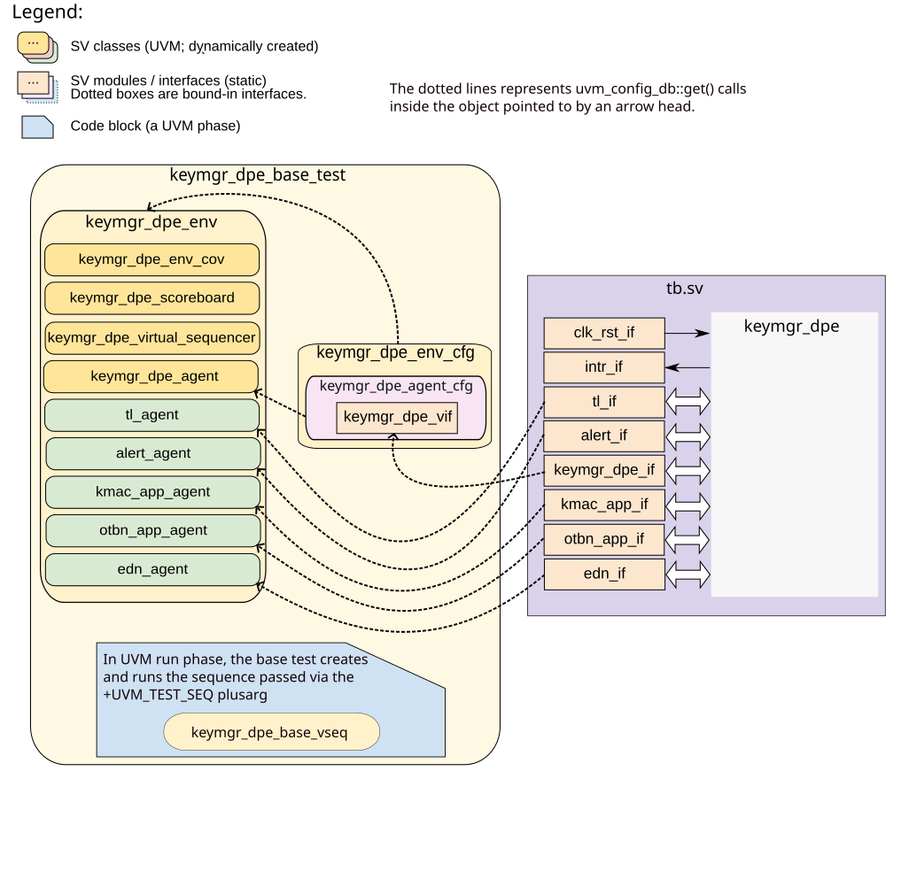

# KEYMGR_DPE DV document

## Goals
* **DV**
  * Verify all the features in the `keymgr_dpe` specification by simulating a UVM component.

* **Coverage**
  * **Code Coverage**: Deliver 100% code coverage to ensure all parts of the HW are exercised.
  * **Functional Coverage**: All `keymgr_dpe` features should be captured in coverage covergroups.

* **FPV**
  * Verify TLUL device protocol compliance and CSR-related assertions with an SVA-based testbench.

## Current status
* [Design & verification sign-off status](../doc/checklist.md)
* [Simulation results](https://reports.opentitan.org/integrated/hw/ip/keymgr_dpe/dv/latest/report.html)

## Design features
For detailed information on `keymgr_dpe` design features, see the
[KEYMGR_DPE HWIP technical specification](../README.md) and the
[Theory of Operation](../doc/theory_of_operation.md).

## Testbench architecture
The `keymgr_dpe` testbench is based on the [CIP testbench architecture](../../../dv/sv/cip_lib/README.md).

### Block diagram


### Top level testbench
The top-level testbench is located at `hw/ip/keymgr_dpe/dv/tb.sv`.
It instantiates the `keymgr_dpe` DUT module `hw/ip/keymgr_dpe/rtl/keymgr_dpe.sv`.

`keymgr_dpe` has the following interfaces:

* [Clock and reset interface](../../../dv/sv/common_ifs/README.md#clk_rst_if).
* [TileLink host interface](../../../dv/sv/tl_agent/README.md) to drive register accesses via TL bus.
* [KMAC app interface](../../../dv/sv/kmac_app_agent/README.md) computes Key Derivation Function (KDF) in KMAC.
* [OTBN app interface]() computes HMAC-based Key Derivation Function (HKDF) in SW running on OTBN.
* [EDN interface](../../../dv/sv/push_pull_agent/README.md) to request a new entropy seed after an interval.
* [pins_if](../../../dv/sv/common_ifs/README.md) for interrupts.
* [Alert interface](../../../dv/sv/alert_agent/README.md) to handle alerts from `keymgr_dpe`.
* HW sideload key interfaces to `AES`, `HMAC`, `KMAC`, and `OTBN`.
* LC interface to enable / disable `keymgr_dpe`.
* ROM interface to get digest for the creation of `CreatorRootKey`.
* Other interfaces are: `Root and Secondary Root Keys`, `Creator seed`, `Owner seed`, and `Device ID`.
  They will get consumed by the key derivation function to generate HW / SW and child keys.
* KMAC masking enable input.
* sensitive_key_o signals OTBN to protect the parent key.
  This should be contained in [OTBN app interface]().

### DV Agents

#### TL Agent
The `keymgr_dpe` is a TLUL device so the register accesses happen via the TLUL interface.
The environment instantiates the [tl_agent](../../../dv/sv/tl_agent/README.md) to drive traffic on the TL interface.

#### EDN Agent
Upon `keymgr_dpe` request, EDN agent feeds a new entropy seed via EDN interface.
This is instantiated with a [push_pull_agent](../../../dv/sv/push_pull_agent/README.md).

#### KMAC app Agent
Upon `keymgr_dpe` request via `kmac_app_o` port, it will respond with a key generated by KDF.
This is instantiated with a [kmac_app_agent](../../../dv/sv/kmac_app_agent/README.md).

#### OTBN app Agent
Upon `keymgr_dpe` request via `otbn_app_o` port, it will respond with a key generated by HKDF.
This is instantiated with an [otbn_app_agent]().

### Scoreboard
The scoreboard implements a model that maintains all the instantiated slots.
The model predicts the working state of the block and the register fields after an operation.
It checks that outputs are routed correctly to SW CSRs or sideload ports.
It verifies slot updates after each operation and predicts errors and alerts.

## Stimulus strategy
UVM sequences will be used for generating stimulus. The stimulus is categorized as:
- **The acceptable stimulus to the keymgr_dpe**:
    This checks that the features promised by `keymgr_dpe` are implemented correctly.
- The acceptable stimulus but triggering a fault in the middle of the operation / transaction.
  This helps with checking the error / alert reporting mechanism in the block.
- **Invalid stimulus**:
    This helps with checking the invalid / unknown stimulus handling of the block.
- **Register testing**:
    This will send register accesses when they are locked or turned back to unlocked.
    It checks that the registers are behaving correctly during and after an operation.
- Others are: generic CSR tests, alerts, sec_cm, TLUL accesses, shadow_reg_errors, etc.
  They are imported from their respective testplans inside keymgr_dpe's [testplan](../data/keymgr_dpe_testplan.hjson).

## Functional coverage
Functional coverage points are defined as part of the [testplan](../data/keymgr_dpe_testplan.hjson).

### Assertions

* **TLUL assertions**:
  The [TLUL protocol checker](../../tlul/doc/TlulProtocolChecker.md) is bound into the design and connected to the TLUL interface.
  This ensures TileLink protocol compliance.
* **Unknown checks on DUT outputs**:
  This ensures all the outputs are initialized to known values after coming out of reset.
* Assertions in `keymgr_dpe` and `keymgr_dpe_ctrl` modules.
  They are related to:
  - FSM and counter errors,
  - register integrity,
  - violations within an operation, etc.

## Building and running tests
The [dvsim](https://github.com/lowRISC/dvsim) tool is used for building and running our tests and regressions.
Please take a look at the link for detailed information on the usage, capabilities, features and known issues.
Here's how to run a smoke test:
```console
$ dvsim $REPO_TOP/hw/ip/keymgr_dpe/dv/keymgr_dpe_sim_cfg.hjson -i keymgr_dpe_smoke
```

## Testplan
[Testplan](../data/keymgr_dpe_testplan.hjson)
