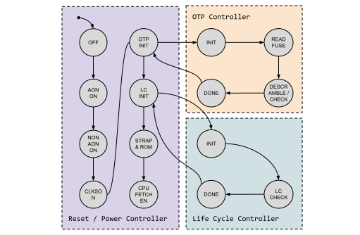
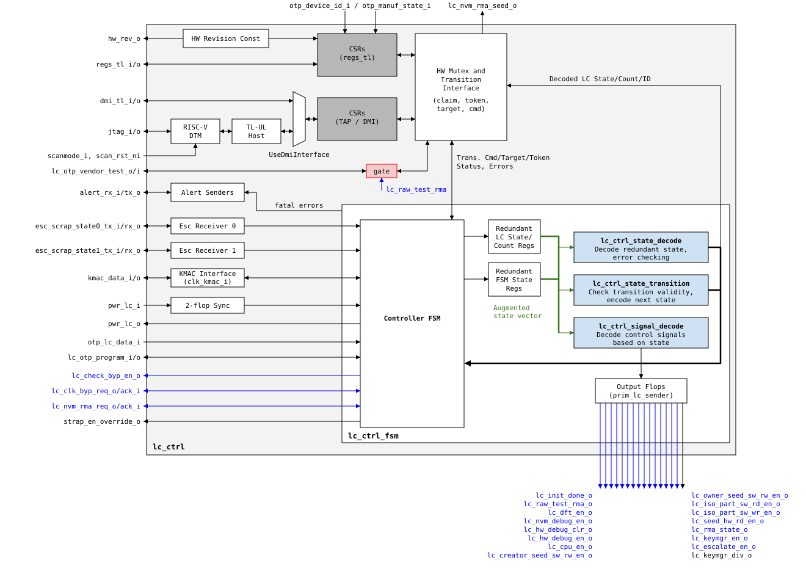
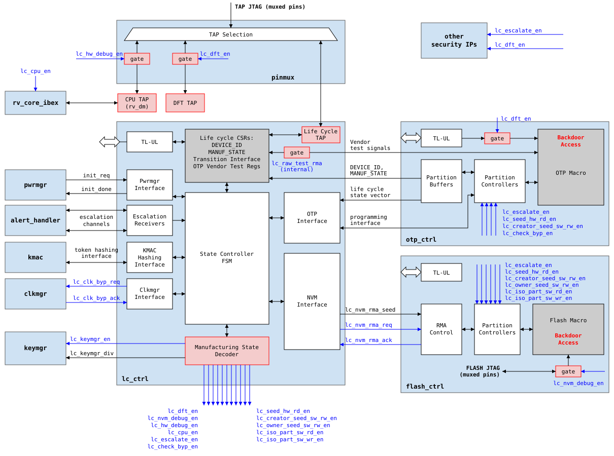
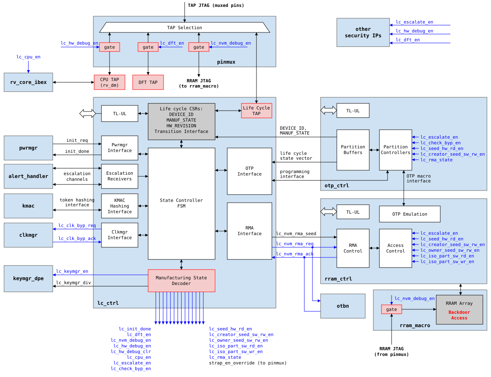
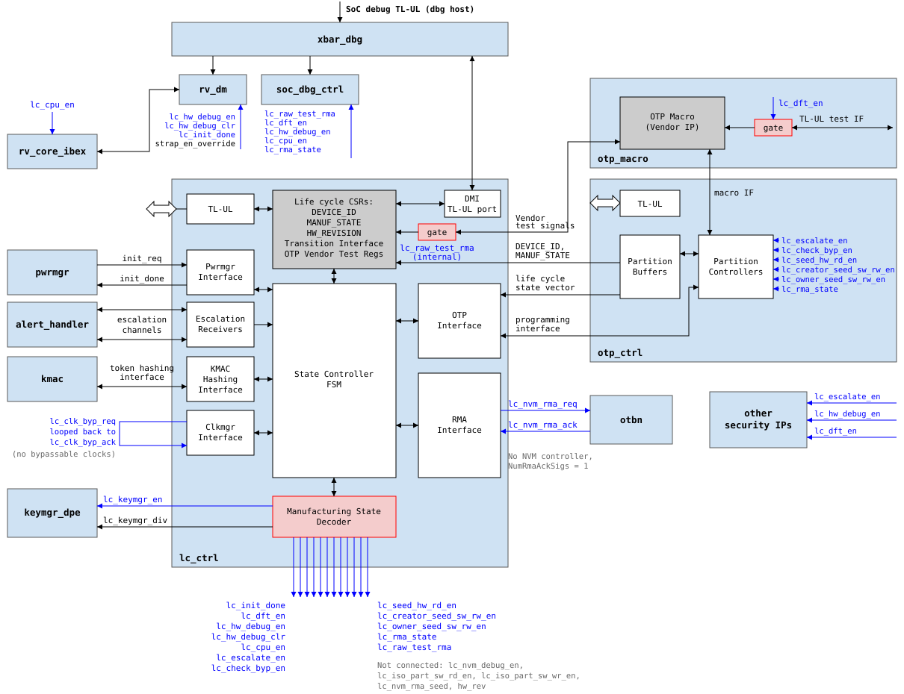
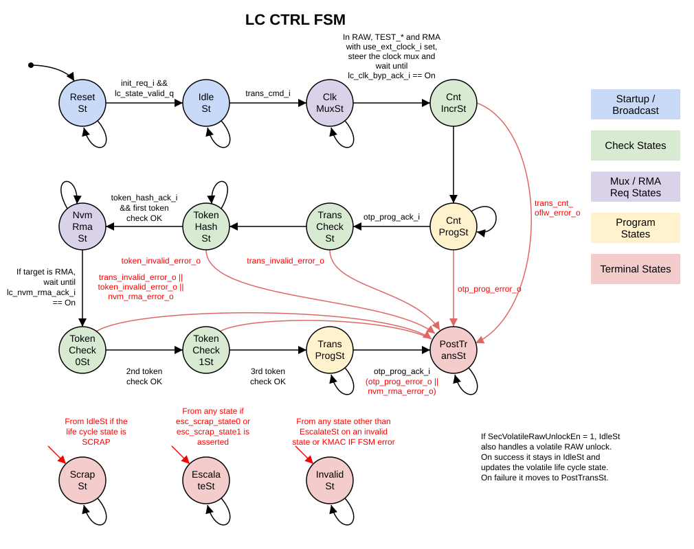
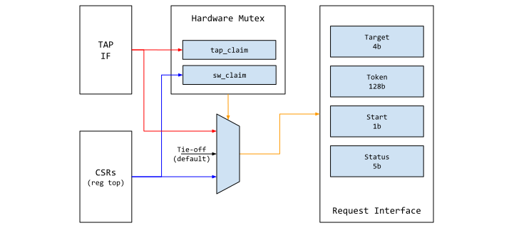

# Theory of Operation

The following sections give an overview of the life cycle function.
It begins with life cycle sensing at power up, progresses through how life cycle transitions are made, and then focuses specifically on how life cycle impacts various functionality of the design.

## Power Up Sequence

Upon power up, the life cycle controller will default to "RAW" state and wait for the OTP controller to initialize and sense the contents of the life cycle partition (for example, see earlgrey's [life cycle partition doc](../../../top_earlgrey/ip_autogen/otp_ctrl/doc/theory_of_operation.md#partition-listing-and-description)).
When the OTP is ready, the life cycle controller reads the contents of the life cycle partition, decodes the life cycle state and updates its internal state to match.
This implies that unlike the life cycle definition diagram, there is a one-time "RAW to any state" logical transition that is implicit within the implementation.
Note during OTP sensing, the life cycle controller does not perform any redundant checks upon the value it reads; instead that responsibility is allocated to the OTP controller.

Once the state values are correctly sensed, the life cycle controller performs checks on state consistency and dependencies, and if correct, broadcasts both the raw state value as well as the decoded functional outputs to the rest of the device.
At the same time, it asserts [INIT_DONE](#init_done) to indicate that these broadcast signals are now valid.

Once the broadcast is complete and signals stable, the pinmux straps are sampled and the ROM check is started.
Note this point is also when it is safe for DFT to commence operations, as DFT functions may be blocked until life cycle completes its broadcast.
Once the ROM check completes, the CPU fetch enable is released.

The following diagram illustrates this power-up sequence.
Note the sequence is not designed into one specific module, but rather a result of coordination between the OTP controller, life cycle controller and the reset / power controllers.



## Normal Operation

Once the life cycle system is powered up and stable, its outputs remain static unless specifically requested to change or affected by security escalation.
The life cycle controller can accept [change requests](#life-cycle-request-interface) from software as well as external entities.

### Unconditional Transitions

For unconditional transitions, the life cycle controller advances the state by requesting an OTP update to the OTP controller.
Once the programming is confirmed, the life cycle controller reports a success to the requesting agent and waits for the device to reboot.

### Conditional Transitions

For conditional transitions, such as those that require a token (RAW_UNLOCK, TEST_UNLOCK, TEST_EXIT, RMA_UNLOCK), the life cycle controller advances the state via OTP programming only after it is supplied with the valid token.
[Some tokens](../../../../doc/security/specs/device_life_cycle/README.md#manufacturing-states) are hardcoded design constants, while others are stored in OTP.
Note that conditional transitions will only be allowed if the OTP partition holding the corresponding token has been provisioned and locked.

Since unlock tokens are considered secret, they are not stored in their raw form.
Instead, the tokens are wrapped and unwrapped based on a global constant using a PRESENT-based scrambling mechanism (for example, see earlgrey's [PRESENT-based scrambling mechanism](../../../top_earlgrey/ip_autogen/otp_ctrl/README.md#secret-vs-non-secret-partitions)).
This ensures that a breach of fuse physical security does not automatically expose all the relevant information without also breaking the constant key.

RAW_UNLOCK is not exposed in the open source design, rather it is something provisioned by the silicon creators prior to tapeout.
It is the only token among those listed that is a global constant and stored in gates.

All others CAN be device unique and are stored in OTP.

### Transition Counter Limits

For conditional transitions, there is a limit to how many times they can be attempted.
This is to prevent an attacker from brute-forcing any specific token, as this also helps to reduce the overall required token size.

For OpenTitan, the total amount of state transitions and transition attempts is limited to 24.
Once this number is reached, the life cycle controller rejects further attempts, effectively locking the device into its current state.

The token counters are maintained in the OTP.
To ensure the security of token limits cannot be bypassed, each request for a conditional transition **FIRST** increments the token count, and **THEN** checks for the validity of the token.

### Token Hashing Mechanism

All 128bit lock and unlock tokens are passed through a cryptographic one way function in hardware before the life cycle controller compares them to the provisioned values in OTP or to the netlist constant in case of RAW_UNLOCK.

This mechanism is used to guard against reverse engineering and brute-forcing attempts.
An attacker able to extract the hashed token values from the scrambled OTP partitions or from the netlist would first have to find a hash collision in order to perform a life cycle transition, since the values supplied to the life cycle controller must be valid hash pre-images.

The employed one way function is a 128bit cSHAKE hash with the function name "" (empty string) and customization string "LC_CTRL", see also [kmac documentation](../../kmac/README.md) and AppCfgLcCtrl in [`kmac_pkg.sv`](https://github.com/lowRISC/opentitan/blob/master/hw/ip/kmac/rtl/kmac_pkg.sv).

### Post Transition Handling

After a transition request, whether it was unconditional or conditional, the life cycle controller always disables all of its decoded outputs and puts the system in an inert state.
It also asserts [HW_DEBUG_CLR](#hw_debug_clr) so that modules clear any stored copy of HW_DEBUG_EN.
The device is then expected to reboot before returning to a functional state.

Note this happens for either successful or unsuccessful transitions.
This general policy places a time-bound on how quickly life cycle states can change and also forces the device to behave more predictably.

## Security Escalation

The life cycle controller contains two escalation paths that are connected to escalation severities 1 and 2 of the alert handler.

The two escalation paths are redundant, and both trigger the same mechanism.
Upon assertion of any of the two escalation actions, the life cycle state is **TEMPORARILY** altered.
I.e. when this escalation path is triggered, the life cycle state is transitioned into "ESCALATE", which behaves like a virtual "SCRAP" state (i.e. this state is not programmed into OTP).
This causes [all decoded outputs](#life-cycle-decoded-outputs-and-controls) to be disabled until the next power cycle.
In addition to that, the life cycle controller asserts the ESCALATE_EN life cycle signal which is distributed to all IPs in the design that expose an escalation action (like moving FSMs into terminal error states or clearing sensitive registers).
The life cycle controller also asserts the [HW_DEBUG_CLR](#hw_debug_clr) life cycle signal.

Whether to escalate to the life cycle controller or not is a software decision, please see the alert handler for more details.

## Life Cycle Decoded Outputs and Controls

The core function of life cycle is how various functions of the design are modulated by what state the design is in.
[This section](../../../../doc/security/specs/device_life_cycle/README.md#manufacturing-states) in the life cycle architecture documentation summarizes the overall behavior.

The signals have been split into two summary tables in the sections below.
The first table contains all control signals that enable certain functionality in the system, whereas the second table contains all signals that change access to certain elements in the non-volatile memories (NVM) and OTP.

All life cycle control signals are 4-bit multibit values of type `lc_tx_t`, where `4'b0101` means ON and `4'b1010` means OFF; any other value is invalid.
A `"Y"` mark means the function is directly enabled by hardware during that
state.
A `"grey"` box means a particular function is not available during that
state.
The states in <span style="color:red">RED</span> are volatile, temporary states.
They exist only after specific events, and are restored to normal once the device is power cycled.

### Life Cycle Function Control Signals

The individual signals summarized in the table below are described in the following subsections.

{{#include lc_ctrl_function_signals_table.md}}

Signals marked with an asterisk (Y\*) are only asserted under certain conditions as explained in detail below.

#### DFT_EN

As its name implies, this signal enables DFT functions.
This is accomplished primarily by providing functional isolation on the SOC inserted DFT TAP module and any other memory macros that are built natively with a DFT function (for example flash, RRAM and OTP).

The isolation ensures three things:
- The TAP controller is unable to issue instructions that would put the design into scan mode.
This ensures that secrets cannot be scanned out, and specific values cannot be scanned into the design to emulate a particular functional mode
- The TAP controller is unable to issue any kind of self test that would disrupt and scramble live logic which could lead to unpredictable behavior
- The TAP controller or test function is unable to alter the non-volatile contents of the NVM or OTP

See [TAP isolation](#tap-and-isolation) for more implementation details.

#### NVM_DEBUG_EN

NVM modules like flash or RRAM implement debug access that bypasses memory protection or lock-down.
This feature may be there for a variety of reasons, but primarily it can be used to debug the normal behavior of the controller.

This type of functionality, if it exists, must be disabled during specific life cycle states.
Since these back-door functions may bypass memory protection, they could be used to read out provisioned secrets that are not meant to be visible to software or a debug host.

Note that NVM_DEBUG_EN is disabled in the last test unlocked state (TEST_UNLOCKED7) such that the isolated NVM partition can be securely populated, without exposing its contents via the NVM backdoor interface.
See also accessibility description of the [isolated NVM partition](#iso_part_sw_rd_en-and-iso_part_sw_wr_en).

#### HW_DEBUG_EN

HW_DEBUG_EN refers to the general ungating of both invasive (JTAG control of the processor, bidirectional analog test points) and non-invasive debug (debug bus observation, and register access error returns).

This signal thus needs to be routed to all security-aware and debug capable peripherals.
This signal is used to determine whether OpenTitan peripheral register interfaces should [silently error](../../../../util/reggen/README.md#error-responses).
If HW_DEBUG_EN is set to ON, normal errors should be returned.
If HW_DEBUG_EN is set to OFF, errors should return silently.

Similar to DFT_EN, HW_DEBUG_EN is also used to isolate the processor TAP.
When HW_DEBUG_EN is OFF, the TAP should not be able to perform its normal debug access, thus preventing an external entity from hijacking the processor.

HW_DEBUG_EN is OFF while the life cycle controller is in reset.
This includes non-debug-module (NDM) resets, which reset the life cycle controller.
In order to keep a debug session alive during an NDM reset, modules can store HW_DEBUG_EN in a flop that is not reset by an NDM reset.
Such a flop must be cleared as described in [HW_DEBUG_CLR](#hw_debug_clr).

#### HW_DEBUG_CLR

HW_DEBUG_CLR instructs modules that store HW_DEBUG_EN in a flop (see [HW_DEBUG_EN](#hw_debug_en)) to clear that flop.
This is necessary because such a flop keeps its value when HW_DEBUG_EN turns OFF.
A module must clear the flop whenever HW_DEBUG_CLR is not OFF.
For example, see the [`pinmux`](../../../top_earlgrey/ip_autogen/pinmux/doc/theory_of_operation.md#non-debug-module-reset) and [`rv_dm`](../../rv_dm/doc/theory_of_operation.md#non-debug-module-reset-support) documentation.

HW_DEBUG_CLR is asserted in the SCRAP, INVALID, POST_TRANSITION and ESCALATION states.
HW_DEBUG_EN is OFF in all of these states.
Once the life cycle controller has entered one of these states, it remains in one of them until it is reset, so HW_DEBUG_CLR remains asserted until then.

HW_DEBUG_CLR is asserted in all states in which ESCALATE_EN is asserted by the life cycle controller.
In addition, HW_DEBUG_CLR is asserted in the POST_TRANSITION state, in which ESCALATE_EN is not asserted.
Note that the life cycle controller enters the POST_TRANSITION state after both successful and unsuccessful transitions (see [Post Transition Handling](#post-transition-handling)).

#### INIT_DONE

INIT_DONE (the `lc_init_done_o` output) indicates that the life cycle controller has completed initialization and that its other broadcast signals are valid, i.e., they are based on the life cycle state read from OTP.

INIT_DONE is OFF while the life cycle controller is in reset and until it has read a valid life cycle state from OTP (see [Power Up Sequence](#power-up-sequence)).
Once ON, INIT_DONE stays ON until the life cycle controller is reset, including in the SCRAP, INVALID, POST_TRANSITION and ESCALATION states.
If the life cycle controller escalates or detects an error before it has read a valid life cycle state, INIT_DONE stays OFF until reset, while ESCALATE_EN and [HW_DEBUG_CLR](#hw_debug_clr) are ON.

Modules that keep a copy of a life cycle signal while the life cycle controller is in reset can use INIT_DONE to decide when to discard that copy and follow the live signal again.
For example, the debug module latches HW_DEBUG_EN when it requests a non-debug-module (NDM) reset, which also resets the life cycle controller, and clears that latch once INIT_DONE is ON (see the [`rv_dm` documentation](../../rv_dm/doc/theory_of_operation.md#non-debug-module-reset-support)).

INIT_DONE is distinct from the `lc_done` response to the power manager and the `STATUS.INITIALIZED` CSR field, which are single-bit indications for the power-up handshake and software.

#### CPU_EN

CPU_EN controls whether code execution is allowed.

This ensures that during specific states (RAW, TEST_LOCKED, SCRAP, INVALID) it is not possible for the processor to execute code that breaks the device out of a non-functional state.

In conjunction with DFT_EN / HW_DEBUG_EN, this acts as the final layer in life cycle defense in depth.

#### KEY_MANAGER_EN

The KEY_MANAGER_EN signal allows the key manager to function normally.
When this signal is logically disabled, any existing key manager collateral is uninstantiated and wiped; further instantiation and generation calls for the key manager are also made unavailable.

The KEY_MANAGER_EN signal is active only during DEV / PROD / PROD_END / RMA.

#### ESCALATE_EN

The ESCALATE_EN signal is available in all life cycle states and is asserted if for any reason the alert subsystem decides to move the life cycle state into the ESCALATION state.
This signal is also unconditionally asserted in all INVALID and SCRAP states (including virtual SCRAP states).

#### CHECK_BYP_EN

The CHECK_BYP_EN signal is used to disable the background consistency checks of the life cycle OTP partition during life cycle transitions to prevent spurious consistency check failures (the OTP contents and the buffer registers can get out of sync during state transitions).
For example, see [earlgrey's background consistency checks](../../../top_earlgrey/ip_autogen/otp_ctrl/doc/theory_of_operation.md#partition-checks).
The CHECK_BYP_EN signal is only asserted when a transition command is issued.

#### CLK_BYP_REQ

If the life cycle state is in RAW, TEST* or RMA, and if [`TRANSITION_CTRL.EXT_CLOCK_EN`](registers.md#transition_ctrl) is set to one, the CLK_BYP_REQ signal is asserted in order to switch the main system clock to an external clock signal.
This functionality is needed in certain life cycle states where the internal clock source may not be fully calibrated yet, since the OTP macro requires a stable clock frequency in order to reliably program the fuse array.
Note that the [`TRANSITION_CTRL.EXT_CLOCK_EN`](registers.md#transition_ctrl) register can only be set to one if the transition interface has been claimed via the [`CLAIM_TRANSITION_IF`](registers.md#claim_transition_if) mutex.
This function is not available in production life cycle states.

For details on the clock switch, please see top_earlgrey's [clkmgr](../../../top_earlgrey/ip_autogen/clkmgr/doc/theory_of_operation.md#life-cycle-requested-external-clock).


### Life Cycle Access Control Signals

The individual signals summarized in the table below are described in the following subsections.

{{#include lc_ctrl_access_signals_table.md}}

Signals marked with an asterisk (Y\*) are only asserted under certain conditions as explained in detail below.

#### CREATOR_SEED_SW_RW_EN and OWNER_SEED_SW_RW_EN

These signals control whether the non-volatile provisioning of life cycle related collateral can be accessed.
The signals can only be active during DEV / PROD / PROD_END / RMA.
During other states, it is not possible to either read or modify the collateral.
This specifically limits the danger of rogue software images during any TEST_UNLOCKED state.
However, as these signals only gate functional access and not DFT access, it is still possible for a malicious agent to bypass this protection by abusing scan shift/capture mechanics.

While the OWNER_SEED_SW_RW_EN is statically enabled in the states shown above, the CREATOR_SEED_SW_RW_EN is only enabled if the device has not yet been personalized (i.e., the OTP partition holding the root key has not been locked down yet).

For a list of the collateral in the NVM and OTP and an explanation of how that collateral is affected by these signals, see the [OTP collateral](#otp-collateral) and [NVM collateral](#nvm-collateral) sections.

#### SEED_HW_RD_EN

The SEED_HW_RD_EN signal controls whether the owner and creator root keys can be accessed by hardware.
This signal is dependent on the personalization state of the device and will only be enabled if the device has been personalized (i.e., when the OTP partition holding the root key has been locked down).

#### RMA_STATE

The RMA_STATE signal states whether the current life cycle state is RMA or not.
The signal is set to `On` when in the RMA state and otherwise to `Off`.

#### ISO_PART_SW_RD_EN and ISO_PART_SW_WR_EN

These signals control whether the isolated NVM partition holding additional manufacturing details can be accessed.
The isolated partition is both read and writable during the PROD / PROD_END / RMA states.
In all other states it is inaccessible, except during the TEST_UNLOCKED* and DEV states where the partition is write-only.
This construction allows to write a value to that partition and keep it secret before advancing into any of the production states.


## OTP Collateral

The following is a list of all life cycle related collateral stored in OTP.
Most collateral also contain associated metadata to indicate when the collateral is restricted from further software access, see [accessibility summary](#otp-accessibility-summary-and-impact-of-life-cycle-signals) for more details.
Since not all collateral is consumed by the life cycle controller, the consuming agent is also shown.

{{#include lc_ctrl_otp_collateral.md}}

The TOKENs and KEYS are considered secret data and are stored in [wrapped format](#conditional-transitions).
Before use, the secrets are unwrapped.

The SECRET0_DIGEST and SECRET2_DIGEST are the digest values computed over the secret partitions in OTP holding the tokens and root keys.
As described in more detail in the OTP controller specification, these digests have a non-zero value once the partition has been provisioned and write/read access has been locked.
For example, see earlgey's [OTP controller specification](../../../top_earlgrey/ip_autogen/otp_ctrl/doc/programmers_guide.md#direct-access-memory-map).

### ID State of the Device

If the SECRET2_DIGEST is zero, the device is considered to have "blank" ID state, in which case the CREATOR_ROOT_KEY_* (in OTP) and CREATOR_DIV_KEY (in the NVM) can be written by software.
All consumers of these keys are supplied with an invalid value.

If the SECRET2_DIGEST has a nonzero value, the device is considered "creator personalized", and the CREATOR_ROOT_KEY and CREATOR_DIV_KEY are no longer accessible to software.
Actual values are supplied to the consumers.
If SECRET2_DIGEST has a nonzero value, the CREATOR_SEED_SW_RW_EN signal will be disabled in PROD, PROD_END and DEV states.

### Secret Collateral

Among the OTP life cycle collateral, the following are considered secrets (note there may be other secrets unrelated to life cycle, for example please see earlgrey's [OTP controller specification](../../../top_earlgrey/ip_autogen/otp_ctrl/doc/theory_of_operation.md#partition-listing-and-description) for more details):

- *_TOKEN
- CREATOR_ROOT_KEY*

Specifically this means after OTP sensing, the above entries are unwrapped to obtain the real value.
Similarly, during programming, they are wrapped before beginning to be written to OTP.

The function used for this wrapping is the lightweight PRESENT-cipher.
The wrapping is a one time event during controlled manufacturing, and unwrapping also cannot be supplied with arbitrary ciphertexts.
Thus the system cannot be abused to generate a large number of traces for informational leakage, and thus a fully hardened cipher (such as masked AES) is not required.

Note also, a global key is used here because there is no other non-volatile location to store a secret key.
If PUFs were available (either in memory form or fused form), it could become an appealing alternative to hold a device unique fuse key.
For example, see earlgrey's [OTP controller](../../../top_earlgrey/ip_autogen/otp_ctrl/doc/theory_of_operation.md#secret-vs-non-secret-partitions) for more details.

### OTP Accessibility Summary and Impact of Life Cycle Signals

A subset of secret collateral is further access-controlled by the life cycle CREATOR_SEED_SW_RW_EN signal.
These are

- RMA_UNLOCK_TOKEN
- CREATOR_ROOT_KEY

The table below summarizes the software accessibility of all life cycle collateral.

{{#include lc_ctrl_otp_accessibility.md}}

Note that CREATOR_SEED_SW_RW_EN is set to OFF if SECRET2_DIGEST has a nonzero value in PROD, PROD_END and DEV states.
SEED_HW_RD_EN only becomes active if SECRET2_DIGEST has a nonzero value in DEV, PROD, PROD_END and RMA states.

## NVM Collateral

The non-volatile memory (NVM) is the embedded flash in Earl Grey 1.0 (`flash_ctrl`) and the RRAM in Earl Grey 2.0 (`rram_ctrl`).
Darjeeling does not have an NVM, so this section does not apply to it.
There, the creator and owner seeds are stored in OTP, and there is no isolated partition.
The NVM contains both memory mapped and non-memory mapped partitions.
As it pertains to life cycle, the NVM contains two sets of important collateral.
They are enumerated in the table below.
Just as with OTP, the consumer and usage of each is also described.

{{#include lc_ctrl_nvm_collateral.md}}

Each collateral belongs to a separate non-memory mapped NVM partition.
The table below enumerates the partition in each integration and whether the partition is memory mapped.

{{#include lc_ctrl_nvm_partitions.md}}

The general NVM partition refers to any software managed storage in the NVM, and is not a specific carve out in the non-memory mapped area.
In Earl Grey 2.0, the isolated partition is the `IsolatedInfoPage` of the RRAM.
The mapping of these info pages to physical RRAM info pages is defined in `rram_ctrl`.

### NVM Accessibility Summary and Impact of Life Cycle Signals

The creator software is trusted to manage the owner partition (OWNER_DATA).
As such, OWNER_DATA remains accessible during DEV / PROD / PROD_END / RMA states, irrespective of the device personalization state.
It is expected that ROM_ext during secure boot programs the protection correctly such that downstream software has appropriate permissions.

The CREATOR_DATA partitions however, are further qualified based on the personalization state of the device.
Just as with OTP, the table below enumerates accessibility of NVM collateral.

{{#include lc_ctrl_nvm_accessibility.md}}

Note that CREATOR_SEED_SW_RW_EN is set to OFF if SECRET2_DIGEST has a nonzero value in PROD, PROD_END and DEV states.
SEED_HW_RD_EN only becomes active if SECRET2_DIGEST has a nonzero value in DEV, PROD, PROD_END and RMA states.
OWNER_SEED_SW_RW_EN is always enabled during DEV, PROD, PROD_END and RMA states.

See also [Device Life Cycle Architecture](../../../../doc/security/specs/device_life_cycle/README.md) for more information on creator/owner isolation.


## Design Details

### Block Diagram

Conceptually speaking, the life cycle controller consists of a large  FSM that is further subdivided into logical modules for maintainability, as illustrated below. All blue blocks in the block diagram are purely combinational and do not contain any registers.



The main FSM implements a linear state sequence that always moves in one direction for increased glitch resistance.
I.e., it never returns to the initialization and broadcast states as described in the [life cycle state controller section](#life-cycle-state-controller).

The main FSM state is redundantly encoded, and augmented with the life cycle state.
That augmented state vector is consumed by three combinational submodules:
- `lc_ctrl_state_decode`: This submodule decodes the redundantly encoded life cycle state, checks that there are no encoding errors and enforces state dependencies as required by the definition. The decoded state is forwarded to the CSRs for SW consumption.
- `lc_ctrl_state_transition`: This submodule checks whether the transition target state specified via the CSRs is valid, and computes the redundantly encoded state vector of the transition target state.
- `lc_ctrl_signal_decode`: This submodule is an output function only and derives the life cycle control signals (colored in blue) and the key manager diversification value from the augmented state vector.
  Its outputs are registered with `prim_lc_sender` instances before they are broadcast.

Note that the three additional life cycle control signals `lc_nvm_rma_req_o`, `lc_clk_byp_req_o` and `lc_check_byp_en_o` are output by the main FSM, since they cannot be derived from the life cycle state alone.
The first two are reactive in nature in the sense that there is a corresponding acknowledgement signal.
The main FSM also drives `strap_en_override_o` after a volatile RAW unlock.

The life cycle controller contains two instances of the same register file.
The first one is accessible via the `regs_tl` TL-UL port.
The second one is accessible either via the life cycle JTAG TAP, which consists of a RISC-V DTM and a TL-UL host adapter, or via the `dmi_tl` TL-UL port if `UseDmiInterface = 1'b1`.
In order to write to the transition interface CSRs, a [hardware mutex](#life-cycle-request-interface) has to be claimed by one of the two sides.
The transition token register also provides the `lc_nvm_rma_seed_o` output.
The OTP vendor test interface is only forwarded while `lc_raw_test_rma` is ON.

The life cycle controller also contains two escalation receivers that are connected to escalation channels 1 and 2 of the alert handler module.
The actions that are triggered by these escalation receivers are explained in the [escalation handling section](#escalation-handling) below.

### System Integration and TAP Isolation

The subsections below provide more context about how the life cycle controller is integrated into the system, and how its control signals interact with various components.
The life cycle controller itself is identical in all integrations.
The integrations mainly differ in the non-volatile memories that store the life cycle state and the secrets protected by it, and in how the debug side accesses the life cycle CSRs.
The table below summarizes the integrations of the OpenTitan tops.

Aspect                          | Flash and OTP macro (Earl Grey 1.0)     | RRAM (Earl Grey 2.0)                       | OTP macro only (Darjeeling)
--------------------------------|-----------------------------------------|--------------------------------------------|-----------------------------------------
NVM controller                  | `flash_ctrl`                            | `rram_ctrl`                                | None
OTP storage                     | Dedicated OTP macro                     | Emulated in the RRAM by `rram_ctrl`        | `otp_macro`
RMA handshake                   | `flash_ctrl` and `otbn`                 | `rram_ctrl` and `otbn`                     | `otbn` only
`NumRmaAckSigs`                 | 2                                       | 2                                          | 1
Debug access to the CSRs        | Life cycle JTAG TAP via the pinmux      | Life cycle JTAG TAP via the pinmux         | DMI TL-UL port via `xbar_dbg` (`UseDmiInterface = 1`)
Vendor test signals             | OTP macro                               | Not connected                              | `otp_macro`
Clock bypass                    | `clkmgr`                                | `clkmgr`                                   | Looped back, no bypassable clocks
Creator and owner seeds         | Flash and OTP                           | RRAM info pages and OTP                    | OTP
Isolated partition              | Flash                                   | RRAM info page                             | None

#### Integration with Flash and an OTP Macro

This integration is used in Earl Grey 1.0, which has `flash_ctrl` with an embedded flash macro and `otp_ctrl` with a dedicated OTP macro.



The life cycle state, the transition counter and the transition tokens are stored in the OTP macro and read by `otp_ctrl`.
`otp_ctrl` consumes `lc_escalate_en`, `lc_seed_hw_rd_en`, `lc_creator_seed_sw_rw_en` and `lc_check_byp_en`.
The test access to the OTP macro is gated with `lc_dft_en`.
The vendor-specific OTP test signals are forwarded from the life cycle controller CSRs to the OTP macro while `lc_raw_test_rma` is ON.

`flash_ctrl` consumes the access control signals for the seed partitions and the isolated partition.
It also implements the RMA handshake via `lc_nvm_rma_seed`, `lc_nvm_rma_req` and `lc_nvm_rma_ack`, together with `otbn`.
The flash macro test TAP is connected to dedicated muxed pins and is gated with `lc_nvm_debug_en`.

Although technically a life cycle feature, the sampling of the strap pins and JTAG / TAP isolation is performed in the pinmux after the life cycle controller has initialized.
See the [pinmux documentation](../../../top_earlgrey/ip_autogen/pinmux/doc/theory_of_operation.md#strap-sampling-and-tap-isolation) and the detailed selection listed in [Life Cycle Definition Table](../../../../doc/security/specs/device_life_cycle/README.md#manufacturing-states).

#### Integration with RRAM

This integration is used in Earl Grey 2.0, which replaces the flash and the OTP macro with `rram_ctrl` and `rram_macro`.



`otp_ctrl` is still the owner of the life cycle state, the transition counter and the transition tokens.
However, it does not have a dedicated OTP macro.
Instead, its macro interface is connected to `rram_ctrl`, which emulates the OTP macro in RRAM.
`otp_ctrl` consumes `lc_escalate_en`, `lc_check_byp_en`, `lc_seed_hw_rd_en`, `lc_creator_seed_sw_rw_en` and `lc_rma_state`.
The vendor-specific OTP test interface of the life cycle controller is not connected.

`rram_ctrl` consumes the access control signals for the seed partitions and the isolated partition.
It also implements the RMA handshake via `lc_nvm_rma_seed`, `lc_nvm_rma_req` and `lc_nvm_rma_ack`, together with `otbn`.

The strap sampling and TAP isolation in the pinmux work as in the integration with flash and an OTP macro.
In addition, the RRAM macro test TAP is selected in the pinmux.
The pinmux only selects it while the `RRAM_JTAG_SEL` CSR is set to True and `lc_nvm_debug_en` is ON.
`rram_macro` additionally gates the TAP with its own synchronized copy of `lc_nvm_debug_en`.

#### Integration with an OTP Macro Only

This integration is used in Darjeeling, which has `otp_ctrl` with `otp_macro` but no NVM controller.



The life cycle state, the transition counter and the transition tokens are stored in `otp_macro` and read by `otp_ctrl`.
As there is no NVM, `otp_ctrl` also consumes `lc_owner_seed_sw_rw_en` in addition to `lc_escalate_en`, `lc_check_byp_en`, `lc_seed_hw_rd_en`, `lc_creator_seed_sw_rw_en` and `lc_rma_state`.
The TL-UL test interface of `otp_macro` is gated with `lc_dft_en`, and the vendor-specific OTP test signals are forwarded to `otp_macro` while `lc_raw_test_rma` is ON.

`otbn` is the only participant of the RMA handshake, hence `NumRmaAckSigs = 1`.
`lc_nvm_debug_en`, `lc_iso_part_sw_rd_en`, `lc_iso_part_sw_wr_en`, `lc_nvm_rma_seed` and `hw_rev_o` are not connected.
Since there are no bypassable clocks, `lc_clk_byp_req` is looped back to `lc_clk_byp_ack`.

The debug side accesses the life cycle CSRs via the DMI TL-UL port (`UseDmiInterface = 1`), which is connected to the SoC debug crossbar `xbar_dbg` next to `rv_dm` and `soc_dbg_ctrl`.
`soc_dbg_ctrl` consumes `lc_raw_test_rma`, `lc_dft_en`, `lc_hw_debug_en`, `lc_cpu_en` and `lc_rma_state`, and `rv_dm` receives `strap_en_override`.

### Life Cycle Manufacturing State Encodings

The encoding of the life-cycle state is used both for OTP storage and as part of the FSM state in the life cycle controller.
In other words the state stored within OTP is not re-encoded before it is consumed as part of the life cycle controller FSM state.

{{#include lc_ctrl_encoding_table.md}}

Any decoding that does not fall into the table above is considered **INVALID**.

Each word in the table above maps to an ECC protected 16bit OTP word (i.e., 16bit + 6bit ECC).
Each word can hold one of six values, ordered from blank to fully programmed:

```
0 -> Ax -> Bx -> Kx -> Lx -> ONE
```

Here, x is the word index, 0 is the blank word and ONE is the word with all 16 data bits set.
Each Ax/Bx/Kx/Lx value used in the LC state is a unique, random netlist constant generated by the silicon creator prior to tapeout based on a custom seed and the employed ECC polynomial.
Each value in this sequence, including its ECC bits, has all bits of the previous value set plus four more.
Hence a word can be incrementally written to any later value in the sequence without producing any ECC errors.

The OTP accesses the life cycle state in blocks of 4 words (64 bits).
The 20 words therefore form 5 blocks: words 0-3, 4-7, 8-11, 12-15 and 16-19.

The table follows these rules:

- Any two states differ in at least two words.
- The states follow additional ordering rules, which are checked by the encoding generator script.
- In the TEST_* states, a single Bx marks the position in the chain.
  The Bx moves through the words in the order 19, 15, 11, 7, 3, 18, 14, 10, 6, 2, 17, 13, 9, 5, 1.
  Words the Bx has already passed are at Kx, all others are at Ax.
- DEV, PROD, PROD_END and RMA are distinguished in words 0, 4, 8, 12 and 16 (one word in each block).
- SCRAP is the only state using ONE.

The purpose of this encoding is to ensure the following

- It is difficult to jump from PROD / PROD_END / SCRAP into DEV
- It is difficult to jump from DEV / PROD / PROD_END / SCRAP into TEST*
- It is difficult to jump from DEV / PROD / PROD_END / SCRAP into RMA

Further, the encoding has been chosen to minimize the probability of successful glitch attacks attempting to alter the value of bits in the life cycle state.
In particular, this encoding guards against attacks that manipulate the OTP to output all-zeros, or attacks that manipulate the OTP to read from other address locations within OTP to inject specific values.

Note that the RAW state is guarded by the RAW_UNLOCK process, which involves supplying a 128bit UNLOCK_TOKEN and performing a full system reset in case the token was correct. Hence moving the state into RAW does not provide any advantage to an attacker.

The encoded life cycle state is not readable by SW in any way through the OTP or life cycle interfaces.
However a decoded version of the manufacturing life cycle is exposed in the [`LC_STATE`](registers.md#lc_state) register.

### Life Cycle Readout Consistency Checks in OTP

In order to guard against glitch attacks during OTP sense and readout, the OTP controller makes sure to read out the life cycle partition before releasing the state to the life cycle controller.
I.e., the OTP controller senses and buffers the life cycle in registers in a first readout pass.
Then, as part of the consistency check mechanism, the OTP controller performs a second and third readout pass to verify whether the buffered life cycle state indeed corresponds to the values stored in OTP.
The second readout pass uses a linearly increasing address sequence, whereas the third readout pass uses a linearly decreasing address sequence (i.e., reads in reverse order).
For example, see earlgrey's [consistency check mechanism](../../../top_earlgrey/ip_autogen/otp_ctrl/doc/theory_of_operation.md#storage-consistency).

### Transition Counter Encoding

The life cycle transition counter has 24 strokes where each stroke maps to one 16bit OTP word.
The strokes are similarly encoded as the life cycle state in the sense that upon the first transition attempt, all words are initialized with unique Cx values that can later be overwritten with unique Dx values without producing an ECC error.

{{#include lc_ctrl_counter_table.md}}

Upon each life cycle transition attempt, the life cycle controller **FIRST** increments the transition counter before initiating any token hashing and comparison operations.

A decoded version of this counter is exposed in the [`LC_TRANSITION_CNT`](registers.md#lc_transition_cnt) register.

### Life Cycle State Controller

The life cycle state controller is the main entity that handles life cycle requests, escalation events and transactions with the OTP and NVM controllers.
The state diagram for the controller FSM is shown below.



Once the FSM has initialized upon request from the power manager, it moves into `IdleSt`, which is the state where all life cycle control signals are broadcast.
The life cycle controller stays in `IdleSt` unless a life cycle state request is initiated via the CSRs.

In that case, the life cycle controller first increments the redundantly encoded life cycle transition counter in `CntIncrSt` and `CntProgSt` in order to fend against brute force attacks.
Then, the transition is checked for validity in `TransCheckSt` and the token hashing operation is initiated in `TokenHashSt`.
A first token comparison is performed when the hashed token returns in `TokenHashSt`, followed by two more comparisons in `TokenCheck0St` and `TokenCheck1St`.
The difference among these three comparisons is that the first comparison is done using the hashed token input directly, whereas the second and the third comparison use a registered version of the hashed token.
If all token checks are successful, the next life cycle state vector is computed and programmed in `TransProgSt`.

Note that an initiated life cycle transition request always ends in `PostTransSt`, no matter whether the transition is successful or not.

#### Escalation Handling

The life cycle controller contains two escalation receivers that are connected to the alert handler (`esc_scrap_state0` and `esc_scrap_state1`).
Both receivers trigger the same action, so the escalation is still effective if one of the two channels is tampered with.

When either channel is asserted, the life cycle controller moves the FSM into `EscalateSt`, which behaves like a "virtual" SCRAP life cycle state.
This transition is not permanent, and will clear upon the next power cycle.
In `EscalateSt`, the life cycle controller asserts the `lc_escalate_en` and `lc_hw_debug_clr` life cycle signals and disables all other life cycle functions except for `lc_init_done`.
`lc_escalate_en` is routed to various security modules in OpenTitan and triggers local wiping and invalidation features.
Note that any scrap state (virtual or encoded in the life cycle state vector) will also cause the `lc_escalate_en` and `lc_hw_debug_clr` life cycle signals to be asserted.

#### FSM Glitch Countermeasures

The FSM has been designed to have a linear control flow that always moves in the same direction, and that always ends in a terminal state after initiating a transition request in order to make glitch attacks harder.
A sparse FSM state encoding is employed, where each state is encoded as a 16bit word with a minimum Hamming distance of 5 w.r.t. any other state.
The FSM state and the life cycle state vector are concurrently monitored, and if an erroneous encoding is detected, the life cycle FSM is immediately moved into the terminal `InvalidSt`, and a `fatal_state_error` alert is asserted.

#### Life Cycle Request Interface

Life cycle requests are the explicit requests made to change life cycle states.
The controller allows requests to come from either the TAP or the software interface.
The interface is common between the two and is maintained as a CSR interface.
To arbitrate between the two, a hardware mutex needs to be obtained before either side can proceed.
The hardware mutex internally acts as a mux to block off the unselected path and all accesses to the request interface are blocked until it is claimed.
If two requests arrive simultaneously, the TAP interface is given priority.

The request interface consists of 7 registers:

1. [`TRANSITION_CTRL`](registers.md#transition_ctrl): Control register for the transition, can be used to switch to an external clock.
2. [`TRANSITION_TARGET`](registers.md#transition_target): Specifies the target state to which the agent wants to transition.
3. [`TRANSITION_TOKEN_*`](registers.md#transition_token): Any necessary token for conditional transitions.
4. [`TRANSITION_CMD`](registers.md#transition_cmd): Start the life cycle transition.
5. [`STATUS`](registers.md#status): Indicates whether the requested transition succeeded.
6. [`OTP_VENDOR_TEST_CTRL`](registers.md#otp_vendor_test_ctrl): See [Macro-specific test control bits](#vendor-specific-test-control-register).
7. [`OTP_VENDOR_TEST_STATUS`](registers.md#otp_vendor_test_status): See [Macro-specific test control bits](#vendor-specific-test-control-register).

If the transition fails, the cause will be reported in this register as well.

See diagram below.



In order to claim the hardware mutex, the value kMuBi8True must be written to the claim register ([`CLAIM_TRANSITION_IF`](registers.md#claim_transition_if)).
If the register reads back as kMuBi8True, then the mutex is claimed, and the interface that won arbitration can continue operations.
If the value is not read back, then the requesting interface should wait and try again later.
Note that all transition registers (with the exception of the [`STATUS`](registers.md#status) register) read back all-zero if the mutex is not claimed.

When an agent is done with the mutex, it releases the mutex by explicitly writing a 0 to the claim register.
This resets the mux to select no one and also holds the request interface in reset.

#### Vendor-specific Test Control Register

Certain OTP macros require special configuration bits to be set during the test phases.
Likewise, it is necessary to expose macro-specific status bits during the test phases.
To this end, the life cycle CSRs contain the [`OTP_VENDOR_TEST_CTRL`](registers.md#otp_vendor_test_ctrl) and [`OTP_VENDOR_TEST_STATUS`](registers.md#otp_vendor_test_status) registers, which are reserved for vendor-specific test control and status bits.
These registers are only active during RAW, TEST_* and RMA life cycle states.
In all other life cycle states, the status register reads back all-zero, and the control register value will be tied to 0 before forwarding it to the OTP macro.

Similarly to the [Life Cycle Request Interface](#life-cycle-request-interface), the hardware mutex must be claimed in order to access both of these registers.
Note that these registers read back all-zero if the mutex is not claimed.

### TAP Construction and Isolation

#### Life Cycle TAP Controller

The life cycle TAP controller is functionally very similar to the [RISC-V debug module](https://github.com/lowRISC/opentitan/blob/master/hw/ip/rv_dm/rtl/rv_dm.sv) for the Ibex processor and reuses the same debug transport module (DTM) and the associated debug module interface (DMI).
The DTM and DMI are specified as part of the [RISC-V external debug specification, v0.13](https://github.com/riscv/riscv-debug-spec/blob/release/riscv-debug-release.pdf) and essentially provide a simple mechanism to read and write to a register space.
In the case of the life cycle TAP controller this register space is essentially the life cycle CSR space.
Hence, the [register table](./registers.md) is identical for both the SW view and the view through the DMI, with the only difference that the byte offsets have to be converted to word offsets for the DMI.

The RISC-V external debug specification defines the two custom JTAG registers 0x10 (DTM control/status) and 0x11 (DMI).
The former provides status info such as idle state, number of address bits and RISC-V specification version plus reset control.
The latter exposes an address, data and operation field for accessing a CSR space.

In order to interact with the LC controller through JTAG, the debugging agent should read out the `abits` field from 0x10 in order to determine the address width in the DMI, and verify that the `version` field is indeed set to 1 to confirm that the DTM implements v0.13 of the spec.
Then, the debugger can issue a CSR read or write operation via the 0x11 register as explained in more detail in [the RISC-V external specification, Chapter 6.1.5](https://github.com/riscv/riscv-debug-spec/blob/release/riscv-debug-release.pdf).

### TAP and Isolation

As currently defined, the life cycle controller TAP is a separate entity from the main SOC DFT TAP and the processor TAP.
This physical separation aids in logical isolation, as the SOC DFT tap can be disabled by DFT_EN, while the processor TAP can be disabled by DEBUG_EN.
The TAP isolation and multiplexing is implemented in the pinmux IP as [described here](../../../top_earlgrey/ip_autogen/pinmux/doc/theory_of_operation.md#strap-sampling-and-tap-isolation).
