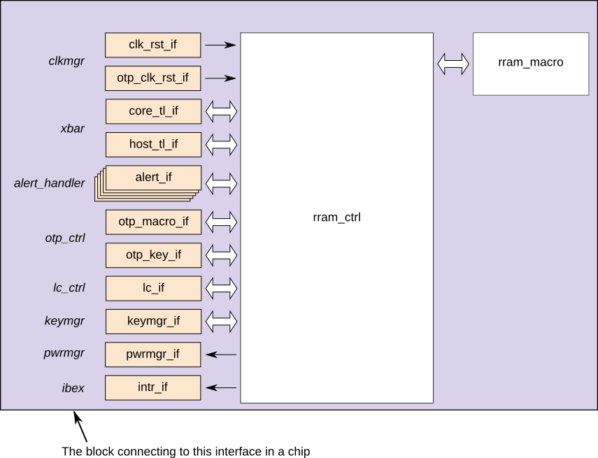
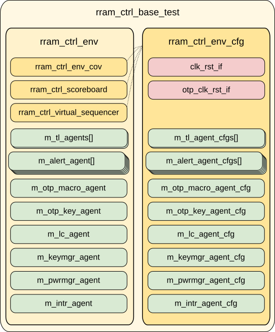

# RRAM_CTRL DV document

## High level structure

To verify the correctness of `rram_ctrl`, the DV is performed in two testbenches:
- A block-level UVM testbench with simulations of the main flows.
- A formal testbench that can use FPV to prove required properties.

The correctness of the block is judged against its [technical specification](../README.md).
There is a list of DV [requirements](requirements.md) extracted from that specification.
The testbenches are designed to allow us to check the behaviour of the design against those requirements.

## UVM testbench

The block-level UVM testbench is built on top of the [CIP testbench architecture](../../../dv/sv/cip_lib/README.md).
The testbench itself has the following structure:



This testbench contains an instantiation of `rram_macro`.
Since this is a testbanch for `rram_ctrl` (not `rram_macro`), this is acting as a testbench component, not a dut.

The base UVM test (from which the other block-level UVM tests are derived) has the following structure:



### Compile-time configurations

Since `rram_ctrl` is a module with parameters, the testbench passes those parameters to the environment through `uvm_config_db`.

### Test agents

As well as the standard components for an OpenTitan environment, `rram_ctrl_env` has the following:

- One [`tl_agent`](../../../dv/sv/tl_agent/README.md) for each TL-UL interface (`core_tl` and `host_tl`)
- One [`alert_agent`](../../../dv/sv/alert_agent/README.md) for each alert (`recov_err`, `fatal_std_err`, `fatal_err`, `fatal_macro_err` and `recov_macro_err`)
- An `rram_otp_ctrl_macro_agent` and a `rram_otp_ctrl_key_agent` representing the connection to `otp_ctrl`.
- An `rram_lc_ctrl_agent` representing the connection to `lc_ctrl`.
- An `rram_keymgr_agent` representing the connection to `keymgr`.
- A passive `rram_pwrmgr_agent` observing the signal sent to `pwrmgr`.
- A passive `rram_intr_agent` observing interrupt signals.

#### OTP macro requests from `otp_ctrl`

Because `rram_ctrl` can represent a fuse macro controller, it instantiates an `otp_macro_if`.
This has an `rram_otp_ctrl_macro_agent` that can send requests (as `otp_ctrl`), which the dut sees on its `otp-hw-if`.

#### OTP key requests to `otp_ctrl`

In the other direction, `rram_ctrl` can request keys from `otp_ctrl` through `otp_key_if`.
These requests might, in turn, cause requests to come back on `otp_macro_if`.
To respond to these requests, there is an `rram_otp_ctrl_key_agent` that tracks the interface and drives responses.

### UVM RAL Model
The `rram_ctrl` RAL model is created with the [`ralgen`](../../../dv/tools/ralgen/README.md) FuseSoC generator script automatically when the simulation is at the build stage.

It can be created manually by invoking [`regtool`](../../../../util/reggen/doc/setup_and_use.md):
```console
$ util/regtool.py -s hw/ip/rram_ctrl/data/rram_ctrl.hjson
```

### Self-checking strategy
#### Scoreboard
`rram_ctrl_scoreboard` extends `cip_base_scoreboard`, which wires up an analysis port per TL agent (core, host, prim) automatically.
Each transaction is dispatched through the overridden `process_tl_access()`, which routes core-CSR accesses to `process_tl_core_access()` and prim accesses to `process_tl_prim_access()` for checking against the register/memory model.

`process_tl_core_access()` itself only dispatches by address kind, to `on_reg_access()` or `on_mem_access()`.
An unmapped address is handled inline instead of through a third handler, since it should be unreachable (see below).
Register prediction (including regwen-gating) is automatic: `rram_ctrl_scoreboard` owns a `uvm_reg_predictor` on the core TL interface, using a `tl_reg_adapter` instance configured the same way as `cip_base_env`'s own (private) frontdoor adapter.
`rram_ctrl_env` connects the core TL monitor to it, since only the env has access to the TL agents.
`on_reg_access()` itself is a no-op today: the read-value check happens on the predictor's side instead, via `ral.default_map.set_check_on_read(1)` (set in `configure_csr_check_exclusions()`, called from `connect_phase`).
This matters because `uvm_reg_predictor::write()` compares the observed read data against the mirror *before* `do_predict()` overwrites it with that same data.
A check in `on_reg_access()` would run too late to be meaningful, since by the time `process_tl_access()` gets to it, prediction has already forced the mirror to match.
`configure_csr_check_exclusions()` also walks every register/field and calls `set_compare(UVM_NO_CHECK)` wherever a `CsrExclCheck`-family exclusion applies in the register spec (e.g. `PHY_STATUS.init_done`, which changes value due to hardware initialization independent of software writes, so the RAL mirror can never predict it.
`rram_ctrl_base_vseq::rram_ctrl_init()` polls exactly this field during DUT bring-up, in every test).
Those excluded fields get no check at all right now.
`on_reg_access()` is where a targeted, hand-rolled check for them would go.
`rram_ctrl_reg_predictor_filter` sits between the TL monitor and the predictor, dropping `d_error`'d items before `uvm_reg_predictor::write()` ever sees them.
This has to happen upstream of the predictor: `uvm_reg_predictor::write()` calls `do_predict()` unconditionally and never checks the bus item's status.
Without the filter, error-injection traffic (e.g. from `run_tl_errors_vseq`) mispredicts rejected writes as successful, and an errored read (`d_data` is undefined per TileLink on `d_error=1`) can corrupt even read-only fields via `UVM_PREDICT_READ`, which overwrites the mirror unconditionally regardless of access policy.
`on_mem_access()` covers the core regfile's `wr_fifo`/`rd_fifo` windows and is currently an empty stub (real FIFO-occupancy tracking is future work).
An unmapped address should be unreachable: `cip_base_scoreboard`'s own `predict_tl_err()` already predicts and checks `d_error` for unmapped addresses generically, before `process_tl_access()` is even called, so `process_tl_core_access()` just flags it with a `uvm_error` inline rather than dispatching to a dedicated handler.

#### Assertions
* TLUL assertions: The `hw/ip/rram_ctrl/dv/uvm/sva/rram_ctrl_bind.sv` binds the `tlul_assert` [assertions](../../../ip/tlul/doc/TlulProtocolChecker.md) to the IP to ensure TileLink interface protocol compliance.
* Unknown checks on DUT outputs: The RTL has assertions to ensure all outputs are initialized to known values after coming out of reset.
* No block-specific assertion properties have been added yet.

### Building and running UVM tests
The [dvsim](https://github.com/lowRISC/dvsim) tool is used for building and running our tests and regressions.
Please take a look at the link for detailed information on the usage, capabilities, features and known issues.
Here's how to run a smoke test:
```console
$ cd $REPO_TOP
$ dvsim hw/ip/rram_ctrl/dv/uvm/rram_ctrl_sim_cfg.hjson -i rram_ctrl_smoke
```

## Formal testbench

**The formal testbench is currently under construction.**

## Testplan
[Testplan](../data/rram_ctrl_testplan.hjson)
