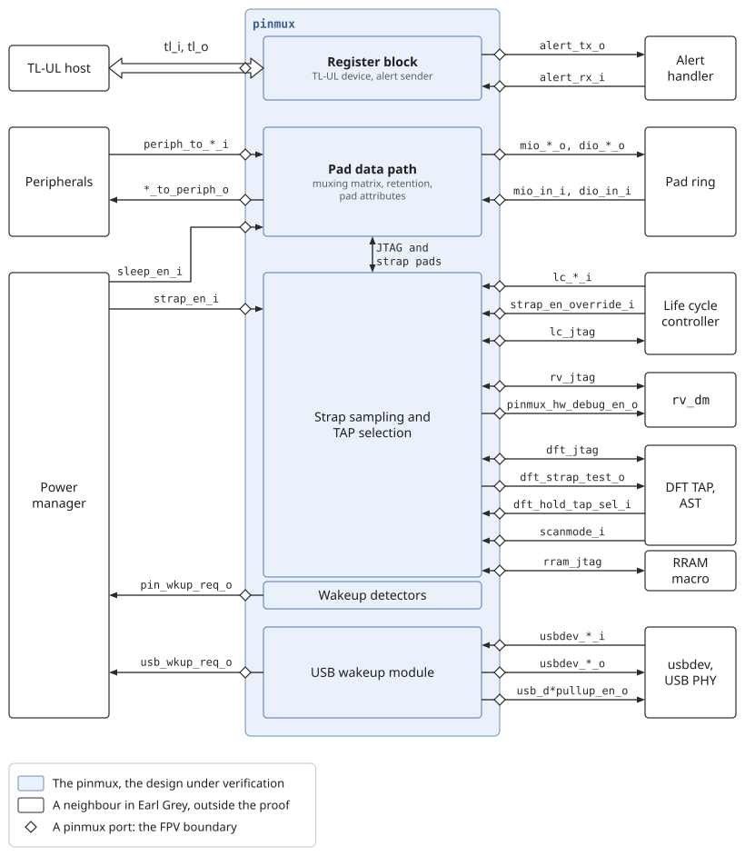
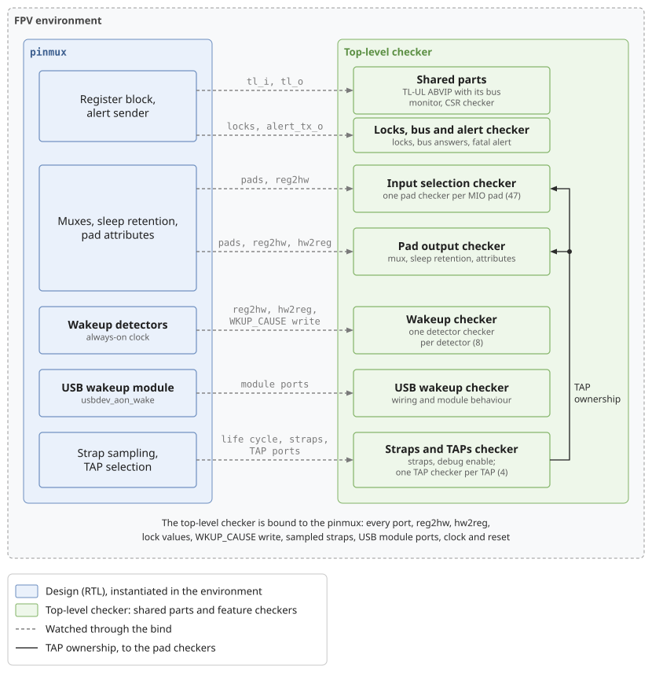

# Pinmux FPV testplan

This page is the plan of a new pinmux FPV environment for Darjeeling.
The environment proves the pinmux requirements for every pad, select value and register setting.
[Scope](#scope) lists what it checks and what it leaves out.
Every assertion traces to a requirement, and every requirement names its source.
The existing pinmux FPV testbench and its testplan stay as they are ([DV document](../dv/README.md)), and this environment is added beside them.

## The pinmux in Darjeeling
The pinmux connects the chip's peripherals to its pads.
A muxed pad (MIO) carries the peripheral signal that software selects for it.
A dedicated pad (DIO) is wired to one peripheral signal.
Software writes the pinmux registers over TL-UL to choose the connections and to set each pad's attributes, such as a pull-up or an inversion.
The top's configuration can limit each peripheral signal to a list of pads.
It also sets the reset value of each select and of each pad's attributes.
The pinmux also does these jobs with its neighbours:

* With the power manager, it holds the pad values during sleep (sleep retention).
  It also wakes the chip when a wakeup detector sees its pattern on a pad.
* To the alert handler, it reports a fatal bus fault.

The environment sits at the pinmux's own ports.
It drives every input and checks every output, and no neighbour is part of a proof.
The table lists the ports of each neighbour and what the environment does with them.
It also lists the clocks and resets, which the figure leaves out.
An input marked free can take any value in any cycle.

| Neighbour | Ports: pinmux inputs; outputs | In the environment |
|---|---|---|
| Peripherals | `periph_to_mio_i`, `periph_to_mio_oe_i`, `periph_to_dio_i`, `periph_to_dio_oe_i`; `mio_to_periph_o`, `dio_to_periph_o` | Peripheral outputs free; the inputs the peripherals read checked |
| Pad ring | `mio_in_i`, `dio_in_i`; `mio_out_o`, `mio_oe_o`, `mio_attr_o`, `dio_out_o`, `dio_oe_o`, `dio_attr_o` | Pad inputs free; pad outputs and attributes checked |
| TL-UL host | `tl_i`; `tl_o` | The host's handshake assumed; its requests free, legal and illegal; the responses checked |
| Alert handler | `alert_rx_i`; `alert_tx_o` | Handler rules assumed; the fatal alert and the ping answers checked |
| Power manager | `sleep_en_i`; `pin_wkup_req_o` | Sleep input assumed; wakeup requests checked |
| DFT and AST | `scanmode_i` | Scan mode free |
| Clock and reset managers | `clk_i`, `clk_aon_i`, `rst_ni`, `rst_aon_ni` | Fixed clock ratio and one reset at the start ([Constraints](#constraints)) |

## How the plan fits together
The plan is a chain of four parts.
Each part points to the next, so a specification section leads to the assertions that check it, and a failing assertion leads back to the specification text.

1. **Specification.**
   The documents that say what the pinmux must do: [Sources](#sources) lists them.
2. **Requirements** ([requirements.md](requirements.md)).
   133 statements of what the pinmux must do, one group per feature.
   Each requirement names its source.
3. **Testpoints** ([testplan](../../data/pinmux_env_fpv_testplan.hjson)).
   15 entries of the testplan.
   The testplan also imports the one testpoint of reggen's CSR checker, `fpv_csr_rw`, so its page shows one more.
   A testpoint is one behaviour of a feature that must be shown to hold, written as one sentence, with the requirements it covers.
   A testpoint is not a module of the testbench.
   The module that proves it is a checker, and one checker proves one or more testpoints ([Feature checkers](#feature-checkers)).
4. **Checks.**
   67 checks, the rows of the testpoints' check tables.
   A check is a sentence that says what must hold.
   65 of them are decided by a planned assertion of their own, named `assert_<Testpoint>_<Check>`.
   [Check kinds](#check-kinds) says what the other checks are.
   A testpoint lists its checks.
   A requirement names what decides it, and why: its checks or the CSR checker.

Two more words describe the testbench.
A checker is a module that holds the assertions of one feature, or of a few related ones ([Feature checkers](#feature-checkers)).
A proof is one run of the formal tool on the assertions of one checker, or of a part of them ([Proofs](#proofs)).

### One example through the chain
| Step | Example |
|---|---|
| Specification | [`MIO_PERIPH_INSEL.IN`](../registers.md#mio_periph_insel); [Muxing Matrix](../theory_of_operation.md#muxing-matrix); [top_darjeeling_pinmux.ipconfig.hjson `n_mio_pads`](../../data/top_darjeeling_pinmux.ipconfig.hjson); [top_darjeeling_pinmux.ipconfig.hjson `mio_periph_ins`](../../data/top_darjeeling_pinmux.ipconfig.hjson) |
| Requirement | [REQ_IN_03](requirements.md#req_in_03): MIO peripheral input `n` shall read the input of MIO pad `p`, in the same cycle, while `MIO_PERIPH_INSEL_n` is 2 + `p` and pad `p` is allowed for input `n`. Here `p` runs from 0 to `NMioPads` - 1. |
| Testpoint | [`pad_listen`](../../data/pinmux_env_fpv_testplan.hjson#pad_listen): every peripheral input reads what its select names. It covers [REQ_IN_01](requirements.md#req_in_01), [REQ_IN_02](requirements.md#req_in_02), [REQ_IN_03](requirements.md#req_in_03), [REQ_IN_04](requirements.md#req_in_04), [REQ_IN_05](requirements.md#req_in_05). |
| Checker | The input selection checker, the module that holds the assertions of `pad_listen` |
| Check | *reads selected pad*, one of the 5 checks of `pad_listen` (*reads tie 0*, *reads tie 1*, *reads selected pad*, *select without a pad reads 0*, *DIO reads its pad*) |
| Planned assertion | `assert_PadListen_ReadsSelectedPad` |
| Why the check proves the requirement | The check compares each MIO peripheral input with `mio_in_i[p]` in the same cycle while its select is 2 + `p`, for every `p` from 0 to `NMioPads` - 1. For an input with a pad list, the check runs only over the pads that the list allows. |

### Sources
Each requirement names its source: a section, a register or a configuration key of the documents below.
Where none of these documents states the rule, the requirement says so.

| Source | Documents | What the plan takes from them |
|---|---|---|
| The pinmux specification | [theory of operation](../theory_of_operation.md), [programmer's guide](../programmers_guide.md), [interfaces](../interfaces.md), [registers](../registers.md), [register description](../../data/pinmux.hjson) | The rules of every feature and register |
| The top | [top description](../../../../data/top_darjeeling.hjson), [pinmux configuration](../../data/top_darjeeling_pinmux.ipconfig.hjson), Earl Grey's [top-level design document](../../../../../top_earlgrey/doc/design/README.md) | The pads and their types, the pad reset attributes, the counts and select ranges, the clocks and resets |
| The neighbours | [power manager](../../../pwrmgr/doc/theory_of_operation.md), [reset manager](../../../rstmgr/doc/theory_of_operation.md), [alert handler](../../../../../top_darjeeling/ip_autogen/alert_handler/doc/theory_of_operation.md) | What each neighbour sends the pinmux and expects back |
| Common rules | [comportability](../../../../../../doc/contributing/hw/comportability/README.md), [TL-UL](../../../../../ip/tlul/README.md), the TileLink specification 1.9.3, [reggen](../../../../../../util/reggen/README.md), [CIP library](../../../../../dv/sv/cip_lib/README.md) | Bus answers, register behaviour and alerts |
| Existing testplans | [existing pinmux FPV testplan](../../data/pinmux_fpv_testplan.hjson), [chip testplan](../../../../../top_darjeeling/data/chip_testplan.hjson) | A rule that no other document states, where an existing testplan describes the behaviour |

### Check kinds
The testplan gives each check a kind:

| Kind | What it says |
|---|---|
| `forward` | When the cause happens, the design responds within the time that the requirement gives. |
| `backward` | The design responds only when the cause happened. |
| `both` | The output equals its expected value in every cycle, which covers both directions. |
| `legal` | The output stays inside its allowed values. |
| `stable` | The output does not change without its cause. |

A check can have two kinds, such as `forward, backward`: it then says both things.
A check that is marked "(through other checks)" has no assertion of its own.
The assertions of other checks decide it, and its row names the requirements that they decide.

## Scope
### Features
The table names the part of the testbench that checks each feature of the pinmux.

| Feature | Checked by |
|---|---|
| Pad input selection | The input selection checker |
| Pad output selection, sleep retention and pad attributes | The pad output checker |
| Attribute locks, bus error handling and the fatal alert | The locks, bus and alert checker |
| The wakeup detectors | The wakeup checker |
| Register access rules: access type, reset value, lock and error causes | The CSR checker |
| The TL-UL protocol on the register bus | The TL-UL ABVIP |

[Testbench architecture](#testbench-architecture) describes each of these parts.

### Security countermeasures
The pinmux register description lists the security countermeasures of the pinmux.
OpenTitan's testplan for them is [`pinmux_sec_cm_testplan.hjson`](../../data/pinmux_sec_cm_testplan.hjson).
The table shows what each countermeasure is and which testpoints of this plan check the behaviour behind it.
These testpoints are due at stage V2S, except `bus`, which is due at stage V2 ([Sign-off criteria per stage](#sign-off-criteria-per-stage)).

| Countermeasure | What it is | Testpoints |
|---|---|---|
| `BUS.INTEGRITY` | Every bus request carries an integrity code. The pinmux raises its fatal alert on a request with a wrong code. | `bus`, `alert` |

### Out of scope
The plan leaves out the cases below.
Each point gives the reason.

* **The TL-UL integrity functions.**
  The environment computes the integrity codes it expects with the same functions that the design uses.
  It therefore checks that the pinmux rejects a wrong code and raises its alert.
  It does not check that the functions compute the right code.
  The FPV testbenches of the two codes, [`prim_secded_inv_64_57`](../../../../../ip/prim/fpv/tb/prim_secded_inv_64_57_tb.sv) and [`prim_secded_inv_39_32`](../../../../../ip/prim/fpv/tb/prim_secded_inv_39_32_tb.sv), check that the decoder flags every single-bit and double-bit error.
* **A reset during a run.**
  Each proof applies every reset once, at the start ([Constraints](#constraints)).
  The proofs therefore do not show what the pinmux does when a reset arrives later.

## Testbench architecture
This is the planned architecture.
The environment instantiates the whole `pinmux` RTL, with its real register block and Darjeeling's pad configuration (pad types and pad roles).
It binds one top-level checker, `pinmux_fpv_env`, to the pinmux.
The top-level checker holds every assertion, assumption and cover of the plan, and every other checker sits inside it.
A bound module is attached to the design and reads its signals, and the design itself stays unchanged.
The top-level checker reads every pinmux port and these internal signals:

* the register values (`reg2hw`, `hw2reg`) and every lock register;
* the always-on side's write of `WKUP_CAUSE`.

The top-level checker has two shared parts and one checker per feature.
The shared parts are described first.

### TL-UL ABVIP
`tlul_abvip` is a set of TL-UL protocol assertions for formal, new with this environment.
ABVIP stands for assertion-based verification IP.
It does two jobs on the pinmux's bus port:

* **Protocol rules.**
  It assumes that the host keeps the TL-UL handshake on `tl_i`.
  It limits the host's requests only in the mask, so a request can be legal or illegal ([Assumptions](#assumptions)).
  It asserts that the pinmux follows the TL-UL rules on `tl_o`.
* **Bus monitor.**
  To check the protocol, the ABVIP follows each request from the cycle the pinmux accepts it to the cycle the pinmux answers it.
  The bus monitor is the part of the ABVIP that reports this to the checkers.
  For each write it reports the address, the data and the byte mask, and whether the pinmux answered without an error.

The checks of the locks, the alert test, the wakeup mode and a failed write read the bus monitor to know what software wrote.
One instance of the ABVIP sits on the pinmux's bus port in every checker proof.
A second instance sits inside the CSR checker, in the register block proof.

### CSR checker
The CSR checker proves the register block.
For every register it checks the access type, the reset value and the lock.
It also checks the answer to every cause of a bus error.

The checker keeps a mirror, which is its own copy of every register field.
It updates the mirror on each write that software makes over the bus and on each write that hardware makes.
The mirror therefore holds the value that each field must have and the value that each read must return, whichever side wrote last.
The checker's assertions compare the register block with the mirror.

reggen already generates a CSR checker from the register description.
The CSR checker of this plan extends it, as the table shows.

| Covered | reggen's generated checker | The CSR checker of this plan |
|---|---|---|
| Registers | The registers that hardware cannot write | Every register. In the pinmux this adds the pad attribute, sleep status and wakeup cause registers, which hardware writes. |
| Error causes | One: a request to an address that no register maps | Every cause |

The extension is a change to reggen's generator.
That change is made and reviewed on its own, and this plan depends on it.
The testpoint `register_block` references that change when it is merged.
Where a requirement's *Checked by* names the CSR checker, it means the extended checker.
The testpoint `register_block` holds the requirements that the extended checker decides.
The imported testpoint `fpv_csr_rw` describes the generated checker without the extension.

For two kinds of pinmux register the mirror alone is not enough.
The CSR checker has one more check for each kind, and a feature checker covers what is left.

| Register | Why the mirror is not enough | What the CSR checker checks | What a feature checker checks |
|---|---|---|---|
| Pad attribute registers | The register block does not store them (`hwext`). The pinmux logic stores the value and supplies it for every read. | A write reaches the pinmux logic in the cycle the register block accepts it. A read returns the value that the pinmux logic supplies in that cycle. | The supplied value is the right one (the checks of `pad_attr`). |
| Wakeup detector registers, except `WKUP_DETECTOR_PADSEL` | The detectors run on the always-on clock, so each write crosses from `clk_i` to `clk_aon_i` (`async`). | The register block answers a bus access to such a register only after the previous write to it has reached the always-on side. | Each write reaches the always-on logic in time and in order (the checks of `wakeup_sync`). |

### Feature checkers
| Checker | What it checks | Testpoints it proves | Its assertions are repeated per |
|---|---|---|---|
| Input selection checker | The input selection of every MIO and DIO peripheral input, with the pad list and the reset selection of each input | `pad_listen`, `sparse_insel`, and the input check of `reset_state` | MIO pad (12) |
| Pad output checker | The output mux, sleep retention and pad attributes, with the pad list of each output and the reset selection of each pad | `pad_output`, `sparse_outsel`, `pad_sleep`, `pad_attr`, and the pad check of `reset_state` | Pad, MIO and DIO |
| Locks, bus and alert checker | The attribute locks; the bus answers, failed requests and the fatal alert | `regwen`, `bus`, `alert`; in `bus`, the protocol check is the TL-UL ABVIP's and the two checks marked "(through other checks)" follow from the CSR checker | Attribute lock (85) |
| Wakeup checker | The wakeup detectors, their cause bits and the wakeup request | `wakeup`, `wakeup_cause`, `wakeup_sync` | Detector (8) |

The last column says what each checker repeats its assertions for.
The formal tool proves each copy on its own, so a failure names the exact pad, lock or detector.
The attribute locks are checked here, and the CSR checker checks every other lock.
Each assertion has the name that its check plans, such as `assert_PadListen_ReadsSelectedPad`, and a comment that names its requirements and its testpoint.
The testpoint `sleep_release` has no assertions of its own.
It follows from the checks of the testpoints above, and the testplan says how.

### Reference value sources
Each assertion compares the design with a reference value, for example the address of a register or the reset value of a pad attribute.
If a checker took such a value from the RTL, a wrong value in the RTL would be wrong on both sides, and the assertion would still pass.
The environment therefore takes its reference values from the descriptions that the RTL is generated from.

| Reference value | Where the environment takes it from |
|---|---|
| Register offsets and field positions | The register order and field layout of the register description, `pinmux.hjson` |
| Pad and peripheral counts, and pad attribute reset values | The top's pinmux configuration, `top_darjeeling_pinmux.ipconfig.hjson`, which topgen writes from the top description |
| The pad types | The top description, `top_darjeeling.hjson` |
| TL-UL integrity codes | The integrity functions of `tlul_pkg`, in the RTL |

The integrity codes are the one reference value that a checker computes with the RTL's own functions, which is why the integrity functions are [out of scope](#out-of-scope).
A requirement of kind `RTL`, or a part of a requirement that carries the mark (*RTL*: ...), is a different case.
Such a requirement writes the design's present behaviour down as a fixed rule, and the checker holds the design to that rule.
The environment also uses the RTL's type definitions of the ports and the register structs, to connect to the design.

## Verification strategy
Three words describe how the proofs are set up:

* An **abstraction** lets a part of the design, or its start state, take more values than it really can, so that one proof covers more cases.
  It removes no real behaviour.
* A **constraint** narrows what the proofs explore.
  Each constraint says what it leaves unchecked.
* An **assumption** is a rule that the environment makes the inputs of the pinmux follow.
  Each assumption names the document that gives the rule, or says that no specification gives it.

### Proofs
The checks are proven in separate proofs.
Each proof runs on the whole design and holds the assertions its row names, with the assumptions they need.

| Proof | Checker | Testpoints | Start state and setup |
|---|---|---|---|
| Register block | CSR checker | `register_block` | The registers start from reset |
| Input selection | Input selection checker | `pad_listen`, `sparse_insel` | The register fields start from any value |
| Pad output | Pad output checker | `pad_output`, `sparse_outsel`, `pad_sleep`, `pad_attr` | The register fields start from any value |
| Locks, bus and alert | Locks, bus and alert checker | `regwen`, `bus`, `alert` | The registers start from reset |
| Wakeup | Wakeup checker | `wakeup`, `wakeup_cause`, `wakeup_sync` | The register fields on `clk_i` start from any value; the detector locks start from reset |
| Reset values | Input selection and pad output checkers | `reset_state`, and the checks of `pad_attr` and `pad_sleep` on the state immediately after reset | The registers start from reset |
| The design's own assertions | None: the assertions written in the RTL | - | The registers start from reset; reported apart from the checkers |

A proof that starts from any register value never sees the reset values.
The checks on the state immediately after reset therefore have a proof of their own, the Reset values row.

### Abstractions
No abstraction edits the RTL.
The column Start state and setup of [Proofs](#proofs) shows which proof uses each one.

| Abstraction | Why the result holds for the design | What another check covers |
|---|---|---|
| The register fields start from any value: each field that only software writes starts with any value. A field that hardware writes, or that is on the always-on clock, starts from reset. | The start values include every setting that software can write from reset. | The Reset values proof and the Register block proof start from reset and check the reset values. |

### Constraints
The last sentence of each constraint says what it leaves unchecked.

* **`clk_aon_i` runs five times slower than `clk_i`.**
  The always-on clock is the slow clock ([Wakeup Features](../programmers_guide.md#wakeup-features)), and the assertions inside the clock-crossing primitive are written for this ratio.
  A check that involves the always-on clock is proven at this ratio only.
  The proofs do not show the pinmux while `clk_i` is stopped.
* **Each reset is applied once, at the start.**
  A reset that can arrive in any cycle multiplies the states that the tool must explore.
  The proofs do not show what a later reset does.
* **No signal integrity error on the alert lines.**
  The environment keeps each signal pair of the alert handler complementary ([Assumptions](#assumptions)).
  The plan does not check how the alert sender answers a pair that is not complementary.
* **No in-band reset of the alert handler.**
  The in-band reset is the alert handler's re-initialization.
  During it, the alert handler puts a signal integrity error on its signal pairs on purpose ([Employed Solution](../../../../../top_darjeeling/ip_autogen/alert_handler/doc/theory_of_operation.md#employed-solution)).
  The proofs do not show the pinmux during an in-band reset.

### Assumptions
Each assumption models a neighbour of the pinmux.
**Models** names the neighbour and the source of the rule, and **Why** says what the proofs need it for.
Every other input is free.

* **The bus host holds each request until the pinmux takes it, and has at most one pending request per source ID** (`tl_i`).
  * **Models:** the bus host, under the rules of the [TL-UL protocol checker](../../../../../ip/tlul/doc/TlulProtocolChecker.md).
    Its requests are free, legal and illegal: the opcode, the size, the address and the integrity codes take any value.
  * **Why:** a host that broke the handshake would make the bus checks fail for a reason outside the pinmux.
    The free requests let the proofs reach every error cause and every failed request.
* **The bus host sends contiguous masks only** (`tl_i`).
  * **Models:** the hosts of OpenTitan, which do not send a non-contiguous mask ([Usage of Opcode, Size and Mask](../../../../../ip/tlul/README.md#usage-of-opcode-size-and-mask)).
  * **Why:** a device may answer a non-contiguous mask with an error or not ([Usage of Opcode, Size and Mask](../../../../../ip/tlul/README.md#usage-of-opcode-size-and-mask)), so no document fixes the pinmux's answer.
    A request with a non-contiguous mask is therefore not checked.
* **The alert handler follows the alert protocol** (`alert_rx_i`): it keeps its signal pairs complementary, follows the four-phase handshake, and sends a new ping at least 4 cycles after the previous handshake is complete.
  * **Models:** the alert handler ([Differential Alert Signaling](../../../../../top_darjeeling/ip_autogen/alert_handler/doc/theory_of_operation.md#differential-alert-signaling), [LFSR Timer](../../../../../top_darjeeling/ip_autogen/alert_handler/doc/theory_of_operation.md#lfsr-timer)).
    No specification bounds its time to answer, so the environment answers each phase of the handshake within 8 `clk_i` cycles.
  * **Why:** a handler that broke the protocol would make a correct alert sender fail its checks.
    The alert sender waits for each answer before it continues, so the alert checks need a bound.
* **The sleep input changes on `clk_i`** (`sleep_en_i`).
  * **Models:** the power manager. No specification names the clock of this input.
  * **Why:** the pinmux registers this input on `clk_i`.
* **Software turns a wakeup detector off before it changes the detector's mode** (`tl_i` writes).
  * **Models:** software, which the theory of operation tells to turn the detector off first ([Wakeup Detectors](../theory_of_operation.md#wakeup-detectors)).
  * **Why:** the pinmux does not clear the detector's counter on a mode change, so no document says what a detector that is on does after one.
    The proofs therefore do not show a mode change on a detector that is on.

The checker proofs do not use the assumptions that are written in the design (`PinmuxWkupStable_A`).

### Vacuity and covers
An assertion is vacuous when its trigger never happens: it then passes without checking anything.
Covers guard against this, and every proof runs its covers before its assertions.
Every proof has at least these covers:

* **Precondition covers**, one per assertion, show that the assertion's trigger can happen.
* **Witness covers**, one per assumption and constraint, show that the environment still allows the legal case it is about, so the environment is not over-constrained.

The wakeup proof also has covers for the cases that need the most cycles: a wakeup count of 255 and the wrap of the counter, about 260 always-on cycles.
A requirement does not close while one of its covers is unreached ([Sign-off criteria per stage](#sign-off-criteria-per-stage)).

### Sign-off criteria per stage
The stages are OpenTitan's [verification stages for FPV](../../../../../../doc/project_governance/development_stages.md), which give the full criteria.
A requirement closes when its checks are proven, their covers are reached, and every check that the abstractions of its proof rely on is proven ([Abstractions](#abstractions)).
Each constraint of its proof must be lifted, or recorded with what it leaves unchecked ([Constraints](#constraints)).

| Stage | OpenTitan's main criteria | In this plan |
|---|---|---|
| V1 | Testplan reviewed, assertions bound, the main functional path proven. | `pad_listen` and `pad_output`: the pad data path, which is the pinmux's main functional path, with the TL-UL ABVIP bound. |
| V2 | Every assertion written, assumptions reviewed, 90 % proven, 90 % code and 75 % cone-of-influence coverage. | Every other functional testpoint, the CSR checker, and the device rules of the TL-UL ABVIP. The plan's own target is 100 % cone-of-influence coverage. |
| V2S | The checks of the security countermeasures pass. | The testpoints of the fatal alert. |
| V3 | Every assertion proven, 100 % code and cone-of-influence coverage. | Every testpoint. |

## Building and running tests
The environment's [dvsim](https://github.com/lowRISC/dvsim) entry has the name `pinmux_env_fpv`.
The entry is added to the formal configuration together with the environment's code.

## Requirements
[requirements.md](requirements.md) holds the 133 requirements, for reading.
[`pinmux_fpv_requirements.hjson`](../../data/pinmux_fpv_requirements.hjson) holds the same rows as data.
126 of them state a rule the specification gives (kind `spec`).
7 state a rule that no specification gives (kind `RTL`).
6 of the `spec` rows mark one part of their rule that no specification gives.
These follow the design's present behaviour.

## Testplan
[Testplan](../../data/pinmux_env_fpv_testplan.hjson)
