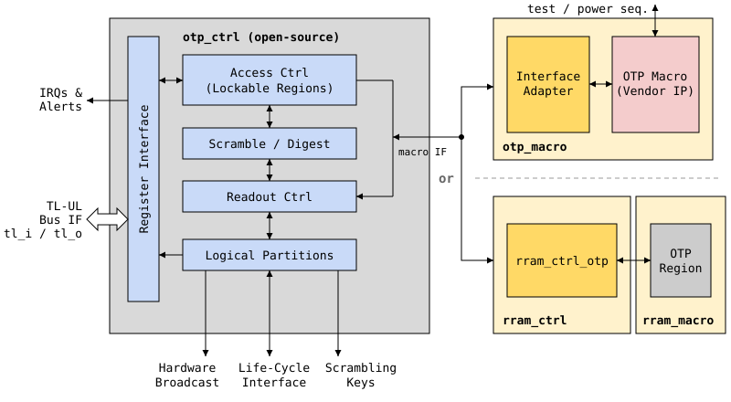

# OTP Controller Technical Specification
<!-- BEGIN CMDGEN util/mdbook_regression_links.py --hjson hw/top_earlgrey/ip_autogen/otp_ctrl/data/otp_ctrl.hjson --top earlgrey -->
| Regression | Version | [Stages](https://opentitan.org/book/doc/project_governance/development_stages.html) | Results |
|-|-|-|-|
 [`otp_ctrl`](https://dashboard.reports.lowrisc.org/opentitan/earlgrey/dashboard.html) | 3.0.0 | D1, V0 |     |

This IP has been taped out in Earl Grey 1.0.0. The corresponding documentation and regression results can be found [here](https://opentitan.org/earlgrey_1.0.0/book/hw/ip/otp_ctrl/index.html).

<!-- END CMDGEN -->

# Overview

This document specifies the functionality of the one time programmable (OTP) memory controller.
The OTP controller is a module that is a peripheral on the chip interconnect bus, and thus follows the [Comportability Specification](../../../../doc/contributing/hw/comportability/README.md).

The OTP is a module that provides a device with one-time-programming functionality.
The result of this programming is non-volatile, and unlike flash, cannot be reversed.
The OTP functionality is constructed through an open-source OTP controller and a backend that provides the non-volatile storage.
The backend is either a dedicated, typically proprietary OTP IP wrapped in `otp_macro`, or `rram_ctrl`, which emulates OTP in a reserved region of the RRAM.
In this top, the backend is `rram_ctrl`.

The OTP controller provides:
- An open-source abstraction interface that software can use to interact with the OTP backend underneath.
- An open-source abstraction interface that hardware components (for example [life cycle controller](../../../ip/lc_ctrl/README.md) and [key manager](../../../ip/keymgr_dpe/README.md)) can use to interact with the OTP backend underneath.
- High level logical security protection, such as integrity checks and scrambling of sensitive content.
- Software isolation for when OTP contents are readable and programmable.

The backend provides:
- Reliable, non-volatile storage.
- Technology-specific redundancy or error correction mechanisms.
- Physical defensive features such as SCA and FI resistance.
- Visual and electrical probing resistance.

Together, the OTP controller and the backend provide secure one-time-programming functionality that is used throughout the life cycle (LC) of a device.
With the `rram_ctrl` backend, the OTP is emulated in a reserved region of the RRAM.
Since the RRAM itself is rewritable, the one-time-programmable behavior is enforced by `rram_ctrl`.
Writes from the OTP controller can only set bits, and software cannot read or program the OTP region through `rram_ctrl`.

## Features

- Multiple logical partitions of the underlying OTP IP
  - Each partition is lockable and integrity checked
  - Integrity digests are stored alongside each logical bank
- Periodic / persistent checks of OTP values
  - Periodic checks of shadowed content vs digests
  - Periodic checks of OTP stored content and shadowed content
  - Persistent checks for immediate errors
- Separate life cycle partition and interface to life cycle controller
  - Supports life cycle functions, but cannot be integrity locked
- Lightweight scrambling of secret OTP partition using a global netlist constant
- Lightweight ephemeral key derivation function for RAM scrambling mechanisms
- Lightweight key derivation function for the NVM (flash or RRAM) scrambling mechanism

## OTP Controller Overview

The functionality of OTP is split into the open-source OTP controller and a backend, with a clearly defined boundary in between, as illustrated in the simplified high-level block diagram below.

This top uses the `rram_ctrl` backend.

It is the task of the open-source controller to provide a common, non-technology specific interface to OTP users with a common register interface and a clearly defined I/O interface to hardware.
The open-source controller implements logical isolation and partitioning of OTP storage that enables users to separate different functions of the OTP into "partitions" with different properties.
Finally, the open-source controller provides a high level of security for specific partitions by provisioning integrity digests for each partition, and scrambling of partitions where required.

The backend on the other hand translates a common access interface, the macro interface, to the underlying storage.
Two backends are available.
- [`otp_macro`](../../../ip/otp_macro/README.md) wraps a dedicated, technology-specific OTP IP, both for functional and debug accesses (for example register accesses to the macro-internal control structure).
  In order to enable simulation and FPGA emulation of the OTP controller even without access to the proprietary OTP IP, `otp_macro` also contains a generalized and synthesizable model of the OTP IP.
- [`rram_ctrl`](../../../ip/rram_ctrl/README.md) emulates OTP in a reserved region of the RRAM.

This split implies that every backend must implement the standardized macro interface.
It also implies that no matter how the OTP storage or word size may change underneath, the open-source controller must present a consistent and coherent software and hardware interface.
The macro interface is described in the [theory of operation](doc/theory_of_operation.md#macro-interface-and-backends).
